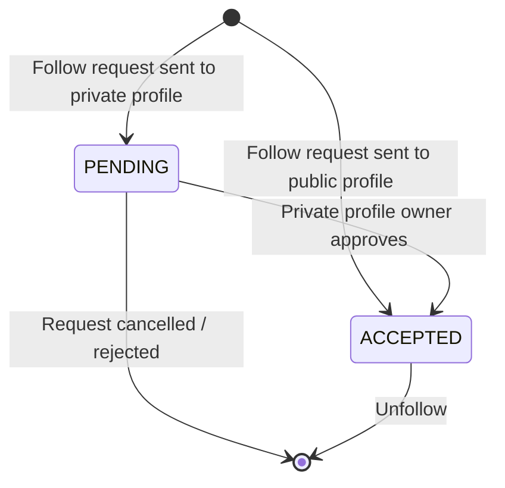

# DDD & Hexagonal Architecture Guide — Innogram Monorepo

**Audience:** Backend and full-stack developers working in the Innogram codebase.  
**Last updated:** 2026-08-10  
**Monorepo root:** `intern-project/`

---

## 1. System Overview & Turborepo Flow

### 1.1 Monorepo Topology

The repository is a **Turborepo-powered monorepo** organized as follows:

```
intern-project/
├── apps/
│   ├── auth_microservice/          # Authentication & user identity (Express.js + Ports & Adapters DDD)
│   ├── core_microservice/          # Social graph, content, interactions (NestJS + Hexagonal Architecture)
│   ├── notifications_consumer_microservice/  # Async event consumers
│   └── client_app/                 # Frontend (consumes @repo/contracts)
├── packages/
│   ├── contracts/                  # → @repo/contracts (zero-dependency API shapes)
│   └── shared/                     # → @repo/shared    (backend infrastructure)
├── turbo.json                      # Turborepo pipeline definition
├── package.json                    # Workspace root (workspaces: ["apps/*", "packages/*"])
└── tsconfig.json
```

### 1.2 Architectural Styles

The monorepo employs **two distinct architectural approaches** tailored to each microservice's complexity:

| Microservice | Framework | DI Strategy | Architecture |
|---|---|---|---|
| `auth_microservice` | Bare Express.js | Manual Dependency Injection | Hexagonal Architecture (Ports & Adapters) with DDD layering |
| `core_microservice` | NestJS | NestJS IoC container (`@Injectable`) | Full Hexagonal Architecture (Ports & Adapters) |

**Why the same architectural style?** Both microservices now follow the Ports & Adapters pattern. `auth_microservice` achieves it with manual DI and Express router factories instead of NestJS decorators, but the layering — domain entities, port interfaces, infrastructure adapters — is the same. `core_microservice` uses NestJS IoC for wiring; the architectural principles are identical. The key difference is that `auth_microservice` has a narrower domain scope (register, login, token management, Google OAuth) and uses a lightweight framework.

Both services share `@repo/shared` (TypeORM base classes, DTOs, domain errors, logger) and `@repo/contracts` (API contracts).

### 1.3 How Turborepo Orchestrates Builds

The root `turbo.json` defines the build pipeline:

```jsonc
// turbo.json (excerpt)
{
  "pipeline": {
    "build": {
      "dependsOn": ["^build"],     // "^build" = build upstream dependencies first
      "outputs": ["dist/**"]
    },
    "dev":    { "dependsOn": ["^build"], "cache": false, "persistent": true },
    "test":   { "dependsOn": ["^build"] },
    "lint":   {},
    "type-check": { "dependsOn": ["^build"] }
  }
}
```

**The `^build` prefix means:** For every task `build` in workspace `X`, Turborepo first runs `build` in all workspaces that `X` depends on. Concretely:

```
packages/contracts   ──build──▶  dist/
packages/shared      ──build──▶  dist/     (depends on contracts? No — contracts is dep-free)
apps/core_microservice ──build──▶ dist/    (depends on @repo/shared, @repo/contracts)
apps/auth_microservice  ──build──▶ dist/   (depends on @repo/shared, @repo/contracts)
apps/client_app         ──build──▶ build/  (depends on @repo/contracts)
```

This ensures the shared packages are compiled before any app consumes them. Running `npm run build` at the root triggers `turbo run build`, which traverses the dependency graph and builds in correct topological order — with parallel execution where possible.

---

## 2. The Package Ecosystem: `@repo/contracts` vs. `@repo/shared`

This is the single most important architectural boundary in the monorepo. These two packages serve **fundamentally different consumers**.

### 2.1 `@repo/contracts` — The API Contract Layer

| Property       | Value |
|----------------|-------|
| Package name   | `@repo/contracts` |
| Dependencies   | **None** (zero runtime deps) |
| Consumed by    | `client_app` (frontend), all microservices |
| Purpose        | Define the **wire format** — the shape of requests and responses |

**Contents:**

```
packages/contracts/src/
├── index.ts                    # Re-exports everything
├── common/
│   ├── index.ts
│   └── responses.ts            # IPaginatedResponse<T>, IPaginationMeta, PAGINATION_DEFAULTS
└── profiles/
    ├── index.ts
    ├── requests.ts             # ICreateProfileRequest, IUpdateProfileRequest
    └── responses.ts            # IProfileResponse
```

Each interface is a **pure TypeScript type** — no decorators, no runtime libraries, no NestJS, no TypeORM:

```typescript
// packages/contracts/src/profiles/requests.ts
export interface ICreateProfileRequest {
  authUserId: string;
  handle: string;          // e.g. "@john_doe"
}

export interface IUpdateProfileRequest {
  displayName?: string;
  bio?: string | null;     // null means "clear the bio"
  avatarUrl?: string | null;
}
```

```typescript
// packages/contracts/src/profiles/responses.ts
export interface IProfileResponse {
  id: string;
  authUserId: string;
  username: string;
  displayName: string;
  bio: string | null;
  avatarUrl: string | null;
  createdAt: string;       // ISO 8601 string, not Date
  updatedAt: string;
}
```

**Why this matters:** The frontend (`client_app`) imports `@repo/contracts` to type its HTTP client calls. Because the package has no dependencies, the frontend bundles no backend code (no TypeORM, no NestJS, no Winston). The contract is the single source of truth for the API surface.

### 2.2 `@repo/shared` — The Backend Infrastructure Toolkit

| Property       | Value |
|----------------|-------|
| Package name   | `@repo/shared` |
| Dependencies   | `@nestjs/common`, `@nestjs/swagger`, `class-validator`, `class-transformer`, `typeorm`, `winston` |
| Consumed by    | Backend microservices only — **never** the frontend |
| Purpose        | Provide reusable backend infrastructure: DTOs, base classes, ports, errors, logging, exception filters |

**Contents (grouped by concern):**

```
packages/shared/src/
├── index.ts                              # Central barrel export
│
├── dtos/
│   ├── auth/
│   │   ├── create-user.dto.ts            # CreateUserDto (auth microservice)
│   │   └── login.dto.ts                  # LoginDto (auth microservice — class-validator decorated)
│   └── core/
│       ├── create-post.dto.ts            # CreatePostDto
│       ├── update-post.dto.ts            # UpdatePostDto
│       ├── create-comment.dto.ts         # CreateCommentDto
│       ├── update-comment.dto.ts         # UpdateCommentDto
│       └── update-profile.dto.ts         # UpdateProfileDto
│
├── database/
│   ├── typeorm-entity.base.ts            # TypeormEntityBase (id, createdAt, updatedAt, deletedAt)
│   ├── repository.port.ts               # RepositoryPort<Entity, EntityProps> interface
│   ├── typeorm-repository.base.ts        # TypeormRepositoryBase<Entity, EntityProps> (adapter)
│   ├── postgres-error-code.enum.ts       # PostgresErrorCode enum (23505, etc.)
│   └── typeorm-error.guard.ts           # isTypeOrmError() type guard
│
├── errors/
│   ├── domain.error.ts                   # DomainError abstract base class
│   └── database.errors.ts                # Concrete errors: EntityByIdNotFoundError, UnauthorizedError, etc.
│
├── filters/
│   └── domain-exception.filter.ts        # DomainExceptionFilter (domain errors → HTTP — NestJS only)
│
├── logger/
│   ├── logger.port.ts                    # Logger interface + LoggerKey DI token
│   ├── winston.logger.ts                 # WinstonLogger (default implementation)
│   └── index.ts
│
└── events/
    └── user-created.event.ts             # UserCreatedEvent (shared event payload)
```

**Key additions for the Express migration:**

- `LoginDto` — class-validator-decorated DTO (`@IsEmail`, `@MinLength(8)`) used by `auth_microservice`'s `POST /auth/login` endpoint, validated via the custom `validateBody` middleware (not NestJS `ValidationPipe`).
- `UnauthorizedError` — framework-agnostic domain error used by `AuthService` to signal invalid credentials, mapped to HTTP 401 by both the NestJS `DomainExceptionFilter` and the Express `errorHandler` middleware.

### 2.3 The Decisive Rule: Where Do New Types Go?

| If the type... | Goes in... | Because... |
|----------------|------------|------------|
| Describes the HTTP request/response wire format | `@repo/contracts` | The frontend needs it without pulling in backend deps |
| Is a DTO with `class-validator` decorators (used by either Express or NestJS) | `@repo/shared/dtos/` | Depends on `class-validator` and optionally `@nestjs/swagger` |
| Is a domain entity, props interface, or repository port | Inside the module's `domain/` folder | Module-specific — not shared |
| Is a reusable base class for multiple microservices | `@repo/shared` | Avoids duplication across services |

---

## 3. Module Anatomy & Hexagonal Architecture — `core_microservice` (NestJS)

> **Note:** This section describes the architecture of `core_microservice`. For `auth_microservice`'s bare Express architecture, see [Section 4](#4-express--manual-di-architecture--auth_microservice).

### 3.1 The Fully-Scaffolded Module: `modules/profiles`

The `profiles` module is the canonical reference implementation. Every new module should mirror its folder structure:

```
modules/profiles/
├── profiles.module.ts                         # NestJS module wiring
├── profiles.controller.ts                     # HTTP entry point
├── profiles.service.ts                        # Application orchestration
│
├── domain/
│   ├── entities/
│   │   ├── user-profile.entity.ts             # Aggregate root (extends TypeormEntityBase)
│   │   ├── user-profile.entity.spec.ts        # Unit tests for domain logic
│   │   └── profile-to-profile-configuration.entity.ts  # Child entity
│   ├── interfaces/
│   │   ├── user-profile.props.ts              # Domain props (pure interface, no TypeORM)
│   │   └── user-profile-repository.port.ts    # Repository port (extends RepositoryPort)
│   └── errors/
│       └── user-profile.errors.ts             # Module-specific domain errors
│
├── dto/
│   ├── create-profile.dto.ts                  # Inbound request DTO
│   └── profile-response.dto.ts                # Outbound response DTO
│
├── infrastructure/
│   └── repository/
│       └── user-profile.repository.ts         # TypeORM adapter (extends TypeormRepositoryBase)
│
└── __tests__/
    └── fakers/
        ├── index.ts
        └── user-profile.faker.ts              # Test data factory
```

### 3.2 The Layers Explained

#### Layer 1: Domain Entities (`domain/entities/`)

Entities are the **heart of the domain**. They extend `TypeormEntityBase` (which provides `id`, `createdAt`, `updatedAt`, `deletedAt`) and encapsulate business rules through methods — never through external validators:

```typescript
// modules/profiles/domain/entities/user-profile.entity.ts

@Entity('user_profiles')
export class UserProfile extends TypeormEntityBase implements UserProfileProps {
  @Index()
  @Column({ type: 'uuid', unique: true })
  authUserId!: string;

  @Column({ type: 'varchar', length: 50, unique: true })
  username!: string;

  @Column({ type: 'varchar', length: DISPLAY_NAME_MAX_LENGTH })
  displayName!: string;

  @Column({ type: 'text', nullable: true })
  bio?: string;

  @Column({ type: 'varchar', nullable: true })
  avatarUrl?: string;

  // Factory: centralizes construction logic (display name defaults to handle)
  static create(props: CreateUserProfileProps): UserProfile {
    const profile = new UserProfile();
    profile.authUserId = props.authUserId;
    profile.username = props.username;
    profile.displayName = props.displayName?.trim() || props.username;
    return profile;
  }

  // Domain method: enforces display name length rule
  rename(displayName: string): void {
    const next = displayName.trim();
    if (next.length === 0 || next.length > DISPLAY_NAME_MAX_LENGTH) {
      throw new InvalidDisplayNameError(displayName);
    }
    this.displayName = next;
  }

  // Domain method: enforces bio length, supports null-to-clear
  editBio(bio: string | null): void {
    if (bio !== null && bio.length > PROFILE_BIO_MAX_LENGTH) {
      throw new InvalidProfileBioError(bio.length);
    }
    this.bio = bio ?? undefined;
  }

  // Domain computed properties
  get hasAvatar(): boolean { return Boolean(this.avatarUrl); }
  get isComplete(): boolean {
    return Boolean(this.displayName) && Boolean(this.bio) && this.hasAvatar;
  }
}
```

**Key principles:**
- Business rules live **inside** the entity, as methods and getters — never in services or controllers.
- Validation failures throw `DomainError` subclasses, which are framework-agnostic and unit-testable.
- A `static create()` factory ensures entities are never constructed in an inconsistent state.
- The entity **directly extends** `TypeormEntityBase` — it is both a domain object and a TypeORM entity. This is a pragmatic choice: separating them into a pure domain model + a separate ORM model would add complexity without benefit at this scale.

The same pattern is used across all domains. For example, `Post` (in `modules/posts`):

```typescript
// modules/posts/domain/entities/post.entity.ts

@Entity('posts')
export class Post extends TypeormEntityBase {
  // ... columns ...

  static create(props: { authorId: string; content: string }): Post {
    const post = new Post();
    post.authorId = props.authorId;
    post.content = props.content;
    post.status = PostStatus.Draft;      // Invariant: new posts are always drafts
    return post;
  }

  publish(): void {
    if (!this.canPublish) {
      throw new InvalidPostStateError(this.status);  // Only drafts can be published
    }
    this.status = PostStatus.Published;
  }

  get canPublish(): boolean {
    return this.status === PostStatus.Draft && this.content.trim().length > 0;
  }
}
```

And `Comment` (in `modules/comments`):

```typescript
// modules/comments/domain/entities/comment.entity.ts

export class EmptyCommentError extends DomainError {
  constructor() { super('Comment content cannot be empty.'); }
}

@Entity('comments')
export class Comment extends TypeormEntityBase {
  // ... columns (postId, authorId, parentId, content) ...

  static create(props: { postId: string; authorId: string; content: string; parentId?: string }): Comment {
    const comment = new Comment();
    comment.postId = props.postId;
    comment.authorId = props.authorId;
    comment.content = props.content;
    comment.parentId = props.parentId;
    return comment;
  }

  edit(content: string): void {
    const next = content.trim();
    if (next.length === 0) throw new EmptyCommentError();
    this.content = next;
  }
}
```

And `PostAsset` (in `modules/posts`), establishing a **1:N relationship** with `Post` that preserves carousel display ordering:

```typescript
// modules/posts/domain/entities/post-asset.entity.ts
import { Entity, Column, ManyToOne, JoinColumn } from 'typeorm';
import { TypeormEntityBase } from '@repo/shared';
import type { Post } from './post.entity';

@Entity('post_assets')
export class PostAsset extends TypeormEntityBase {
  @Column({ type: 'uuid' })
  postId!: string;

  @ManyToOne(() => Post, (post) => post.assets)
  @JoinColumn({ name: 'postId' })
  post!: Post;

  @Column()
  assetUrl!: string;

  @Column({ type: 'int', default: 0 })
  displayOrder!: number;   // Preserves carousel ordering — asset[0], asset[1], etc.

  @Column({ type: 'varchar', nullable: true })
  assetType?: string;       // e.g. 'image', 'video'

  static create(props: { postId: string; assetUrl: string; displayOrder: number; assetType?: string }): PostAsset {
    const asset = new PostAsset();
    asset.postId = props.postId;
    asset.assetUrl = props.assetUrl;
    asset.displayOrder = props.displayOrder;
    asset.assetType = props.assetType;
    return asset;
  }
}
```

The relationship is mapped on the `Post` side via `@OneToMany`:

```typescript
// Inside Post entity:
@OneToMany(() => PostAsset, (asset) => asset.post, { cascade: true, eager: true })
assets!: PostAsset[];
```

**Design rationale:** Assets are loaded eagerly with the post because the carousel is a core part of the post's visual presentation. The `displayOrder` integer field preserves the user-defined ordering of assets within the carousel, ensuring deterministic rendering regardless of database insertion order.

#### Layer 2: Domain Interfaces (`domain/interfaces/`)

Two kinds of interfaces live here:

**a) Props interfaces** — pure data shapes decoupled from TypeORM. These type the repository's query parameters:

```typescript
// modules/profiles/domain/interfaces/user-profile.props.ts
export interface UserProfileProps {
  authUserId: string;
  username: string;
  displayName: string;
  bio?: string;
  avatarUrl?: string;
}
```

**b) Repository ports** — abstractions the service depends on. This is the "port" in "Ports and Adapters":

```typescript
// modules/profiles/domain/interfaces/user-profile-repository.port.ts
import type { RepositoryPort } from '@repo/shared';
import type { UserProfile } from '../../domain/entities/user-profile.entity';
import type { UserProfileProps } from './user-profile.props';

export interface IUserProfileRepository
  extends RepositoryPort<UserProfile, UserProfileProps> {
  // Domain-specific finders beyond the generic RepositoryPort surface
  findByAuthUserId(authUserId: string): Promise<UserProfile | null>;
}

// DI token for injecting by interface rather than concrete class
export const UserProfileRepositoryKey = Symbol.for('IUserProfileRepository');
```

The `RepositoryPort<Entity, EntityProps>` is defined in `@repo/shared` and represents the **complete generic data-access contract** — find, save, delete, paginate, count, exists, upsert, soft-delete:

```typescript
// packages/shared/src/database/repository.port.ts (abridged)
export interface RepositoryPort<Entity, EntityProps>
  extends
    DeleteOne<Entity>, DeleteMultiple<Entity>, DeleteByCriteria<EntityProps>,
    FindMany<Entity, EntityProps>, FindManyPaginated<Entity, EntityProps>,
    FindOne<Entity, EntityProps>, FindOneByIdOrThrow<Entity>,
    FindOneOrThrow<Entity, EntityProps>, Save<Entity>, SaveMultiple<Entity>,
    SoftDelete<Entity>, Count<EntityProps>, Exists<EntityProps>, Upsert<Entity> {}
```

#### Layer 3: Domain Errors (`domain/errors/`)

Module-specific errors that encode domain rule violations:

```typescript
// modules/profiles/domain/errors/user-profile.errors.ts
import { DomainError } from '@repo/shared';

export class InvalidDisplayNameError extends DomainError {
  constructor(value: string) {
    super(`Display name "${value}" is invalid: it must be 1–100 characters.`);
  }
}

export class InvalidProfileBioError extends DomainError {
  constructor(length: number) {
    super(`Profile bio is too long: ${length} characters (max 160).`);
  }
}
```

All domain errors extend the shared `DomainError` abstract class:

```typescript
// packages/shared/src/errors/domain.error.ts
export abstract class DomainError extends Error {
  protected constructor(message: string) {
    super(message);
    this.name = new.target.name;
    Object.setPrototypeOf(this, new.target.prototype);
  }
}
```

The `DomainExceptionFilter` (registered globally in `main.ts`) catches all `DomainError` subclasses and maps them to appropriate HTTP status codes:

| Error class | HTTP status |
|-------------|-------------|
| `EntityByIdNotFoundError` | 404 Not Found |
| `EntityNotFoundError` | 404 Not Found |
| `UniqueConstraintViolationError` | 409 Conflict |
| `UnauthorizedError` | 401 Unauthorized |
| `DatabaseQueryError` | 500 Internal Server Error |
| Any other `DomainError` subclass (e.g. `InvalidDisplayNameError`) | 400 Bad Request |

This means entities can throw business errors without knowing anything about HTTP. The same filter pattern also maps domain errors thrown during post archiving — if a user attempts to archive a post they do not own, an `UnauthorizedError` is raised (→ 401), providing **IDOR protection** at the architectural boundary rather than through ad-hoc checks in every controller.

#### Layer 4: DTOs (`dto/`)

**Inbound DTOs** carry validation decorators and can optionally implement a `@repo/contracts` interface:

```typescript
// modules/profiles/dto/create-profile.dto.ts
export class CreateProfileDto implements ICreateProfileRequest {
  @ApiProperty({ example: '123e4567-e89b-12d3-a456-426614174000' })
  @IsUUID()
  authUserId!: string;

  @ApiProperty({ example: 'john_doe' })
  @IsString()
  @MinLength(3)
  @MaxLength(30)
  handle!: string;
}
```

**Note:** Some DTOs that are shared across microservices live in `@repo/shared/dtos/` (e.g. `CreatePostDto`, `UpdateProfileDto`, `LoginDto`, `CreateUserDto`). Module-specific DTOs that are tightly coupled to one module live inside the module's `dto/` folder (e.g. `CreateProfileDto`).

**Outbound DTOs** (response DTOs) are constructed from entities. They are the translation layer between the domain and the wire:

```typescript
// modules/profiles/dto/profile-response.dto.ts
export class ProfileResponseDto implements IProfileResponse {
  @ApiProperty() id: string;
  @ApiProperty() authUserId: string;
  @ApiProperty() username: string;
  @ApiProperty() displayName: string;
  @ApiProperty({ type: String, nullable: true }) bio: string | null;
  @ApiProperty({ type: String, nullable: true }) avatarUrl: string | null;
  @ApiProperty() createdAt: string;
  @ApiProperty() updatedAt: string;

  constructor(profile: UserProfile) {
    this.id = profile.id;
    this.authUserId = profile.authUserId;
    this.username = profile.username;
    this.displayName = profile.displayName;
    this.bio = profile.bio ?? null;         // normalize undefined → null
    this.avatarUrl = profile.avatarUrl ?? null;
    this.createdAt = profile.createdAt.toISOString();   // Date → ISO string
    this.updatedAt = profile.updatedAt.toISOString();
  }
}
```

The post response DTO follows the exact same pattern:

```typescript
// modules/posts/dto/post-response.dto.ts
export class PostResponseDto {
  @ApiProperty() id: string;
  @ApiProperty() authorId: string;
  @ApiProperty() content: string;
  @ApiProperty({ enum: PostStatus }) status: PostStatus;
  @ApiProperty() createdAt: string;
  @ApiProperty() updatedAt: string;

  constructor(post: Post) {
    this.id = post.id;
    this.authorId = post.authorId;
    this.content = post.content;
    this.status = post.status;
    this.createdAt = post.createdAt.toISOString();
    this.updatedAt = post.updatedAt.toISOString();
  }
}
```

#### Layer 5: Infrastructure — Repository Adapter (`infrastructure/repository/`)

This is the "adapter" in "Ports and Adapters." It extends `TypeormRepositoryBase` from `@repo/shared`:

```typescript
// modules/profiles/infrastructure/repository/user-profile.repository.ts
@Injectable()
export class UserProfileRepository
  extends TypeormRepositoryBase<UserProfile, UserProfileProps>
  implements IUserProfileRepository
{
  public static readonly entity = UserProfile;
  protected relations: string[] = [];   // no default joined relations

  constructor(@InjectRepository(UserProfile) repository: Repository<UserProfile>) {
    super(repository);
  }

  // Domain-specific finder
  public async findByAuthUserId(authUserId: string): Promise<UserProfile | null> {
    return this.repository.findOne({ where: { authUserId } });
  }
}
```

By extending `TypeormRepositoryBase`, the concrete repository **inherits the full data-access surface** (save, findOneByIdOrThrow, findManyPaginated, softDelete, upsert, etc.) without writing a single line of repetitive code. The base class handles:

- Converting string-array relations to TypeORM's nested object format
- Logging every persistence operation
- Catching TypeORM `QueryFailedError` and translating unique violations into `UniqueConstraintViolationError`
- Implementing `findOneByIdOrThrow` / `findOneOrThrow` with proper `EntityByIdNotFoundError` / `EntityNotFoundError` throws

The post repository demonstrates a repository with default relations:

```typescript
// modules/posts/infrastructure/repository/post.repository.ts
@Injectable()
export class PostRepository extends TypeormRepositoryBase<Post, PostProps> {
  public static readonly entity = Post;
  protected relations: string[] = ['author'];  // author profile joined on every read

  constructor(@InjectRepository(Post) repository: Repository<Post>) {
    super(repository);
  }
}
```

The comment repository adds a domain-specific finder:

```typescript
// modules/comments/infrastructure/repository/comment.repository.ts
@Injectable()
export class CommentRepository extends TypeormRepositoryBase<Comment, CommentProps> {
  public static readonly entity = Comment;
  protected relations: string[] = ['author'];

  constructor(@InjectRepository(Comment) repository: Repository<Comment>) {
    super(repository);
  }

  async findByPost(postId: string): Promise<Comment[]> {
    return this.repository.find({
      where: { postId },
      relations: { author: true },
      order: { createdAt: 'DESC' },
    });
  }
}
```

#### Layer 6: Service (`profiles.service.ts`)

The service orchestrates the domain — it does not contain business rules. It fetches entities, calls their domain methods, and persists:

```typescript
// modules/profiles/profiles.service.ts
@Injectable()
export class ProfilesService {
  constructor(private readonly userProfileRepository: UserProfileRepository) {}

  async createProfile(authUserId: string, handle: string): Promise<UserProfile> {
    // Entity factory knows how to build a valid profile
    const profile = UserProfile.create({ authUserId, username: handle });
    return this.userProfileRepository.save(profile);
  }

  async getProfile(id: string): Promise<UserProfile> {
    return this.userProfileRepository.findOneByIdOrThrow(id);
    // ↑ throws EntityByIdNotFoundError (→ 404 via DomainExceptionFilter)
  }

  async updateOwnProfile(
    profileId: string,
    authUserId: string,
    updateDto: UpdateProfileDto,
  ): Promise<UserProfile> {
    const profile = await this.getProfile(profileId);
    // IDOR protection: verify the JWT subject owns this profile
    if (profile.authUserId !== authUserId) {
      throw new UnauthorizedError('You can only update your own profile');
    }
    // Mutations go through entity domain methods — not raw property assignment
    if (updateDto.bio !== undefined) {
      profile.editBio(updateDto.bio ?? null);  // throws InvalidProfileBioError if too long
    }
    return this.userProfileRepository.save(profile);
  }
}
```

**Key change:** The `updateProfile` method was replaced with `updateOwnProfile`, which accepts the authenticated `authUserId` (extracted from the JWT by `@CurrentUser()`) and asserts ownership before applying mutations. This prevents **Insecure Direct Object Reference (IDOR)** attacks — a user cannot modify another user's profile by guessing a UUID.

#### Layer 7: Controller (`profiles.controller.ts`)

The controller is a thin translation layer: validate input → call service → map entity to response DTO. All mutating endpoints are protected by `JwtAuthGuard` (see [Section 3.4](#34-security--authentication)) and use `@CurrentUser` for IDOR-safe ownership validation:

```typescript
// modules/profiles/profiles.controller.ts
@ApiTags('Profiles')
@Controller('profiles')
export class ProfilesController {
  constructor(private readonly profilesService: ProfilesService) {}

  @Get(':id')
  async getProfile(@Param('id', ParseUUIDPipe) id: string): Promise<ProfileResponseDto> {
    return new ProfileResponseDto(await this.profilesService.getProfile(id));
  }

  @Patch(':id')
  @UseGuards(JwtAuthGuard)
  async updateProfile(
    @Param('id', ParseUUIDPipe) id: string,
    @Body() updateProfileDto: UpdateProfileDto,
    @CurrentUser() user: JwtPayload,
  ): Promise<ProfileResponseDto> {
    const profile = await this.profilesService.updateOwnProfile(id, user.sub, updateProfileDto);
    return new ProfileResponseDto(profile);
  }
}
```

**Key security changes from the original design:**
- `POST /profiles` was **removed**. Profiles are no longer created via a public HTTP endpoint. They are created internally by `InternalEventsModule` when a `UserCreatedEvent` is received from `auth_microservice` (see [Section 7](#7-inter-service-communication-auth--core)).
- `PATCH /profiles/:id` is protected by `JwtAuthGuard` — the Core service independently validates the JWT using the shared `JWT_ACCESS_SECRET` without needing a database call.
- The `@CurrentUser()` decorator extracts the authenticated `JwtPayload` from the request context. The service then compares `user.sub` against the profile's `authUserId` to enforce **IDOR protection** (users can only update their own profile).

#### Layer 8: Module (`profiles.module.ts`)

The module wires everything together via NestJS DI. The `ProfilesModule` is consumed by the `InternalEventsModule` (see [Section 3.3](#33-internaleventsmodule--event-driven-profile-creation)) for event-driven profile creation and exposes its `ProfilesService` for inter-module use:

```typescript
// modules/profiles/profiles.module.ts
@Module({
  imports: [TypeOrmModule.forFeature([UserProfile, ProfileToProfileConfiguration])],
  controllers: [ProfilesController],
  providers: [ProfilesService, UserProfileRepository],
  exports: [ProfilesService],   // ← exported so InternalEventsModule can call createProfile()
})
export class ProfilesModule {}
```

---

### 3.3 InternalEventsModule & Event-Driven Profile Creation

To avoid the "God Object" anti-pattern where one module handles unrelated concerns, a dedicated `InternalEventsModule` intercepts incoming events from `auth_microservice` and delegates to the appropriate domain module:

```typescript
// modules/internal-events/internal-events.module.ts
@Module({
  imports: [ProfilesModule],   // imports for ProfilesService
  controllers: [InternalEventsController],
})
export class InternalEventsModule {}
```

```typescript
// modules/internal-events/internal-events.controller.ts
@Controller('internal/events')
export class InternalEventsController {
  constructor(private readonly profilesService: ProfilesService) {}

  @Post('user-created')
  async handleUserCreated(@Body() event: UserCreatedEvent): Promise<void> {
    await this.profilesService.createProfile(
      event.userId,
      event.email.split('@')[0],   // derive initial handle from email
    );
  }
}
```

**Architectural rationale:**

- `InternalEventsModule` is a **routing layer** — it receives events via HTTP and fans them out to the appropriate domain service. It contains no business logic.
- This decouples `ProfilesModule` from external system concerns. `ProfilesService` has no awareness that profiles are created as a side-effect of user registration — it simply exposes `createProfile(authUserId, handle)`.
- The controller path `internal/events` is **not publicly exposed** — it is reachable only within the Docker network via the service name `core_microservice`.
- A message broker (RabbitMQ) will be introduced in the future exclusively for the `notifications_consumer_microservice` — not for Auth → Core profile creation, which remains event-driven over HTTP. The delegation pattern in this module (controller → domain service) stays identical regardless of transport.

### 3.4 Security & Authentication

`core_microservice` now independently validates JWTs issued by `auth_microservice` without requiring a database connection or an API call back to the Auth service. This is achieved through shared secrets and NestJS guard/decorator patterns.

#### `JwtAuthGuard`

A NestJS guard that extracts the Bearer token from the `Authorization` header, verifies it using the shared `JWT_ACCESS_SECRET` (from `.env`), and attaches the decoded payload to the request context:

```typescript
// common/guards/jwt-auth.guard.ts
@Injectable()
export class JwtAuthGuard implements CanActivate {
  canActivate(context: ExecutionContext): boolean {
    const request = context.switchToHttp().getRequest();
    const token = this.extractToken(request);
    if (!token) throw new UnauthorizedError('Missing access token');

    try {
      const payload = jwt.verify(token, env.jwt.accessSecret) as JwtPayload;
      request.user = payload;   // attach to request for @CurrentUser()
      return true;
    } catch {
      throw new UnauthorizedError('Invalid or expired access token');
    }
  }

  private extractToken(request: Request): string | null {
    const header = request.headers.authorization;
    if (!header?.startsWith('Bearer ')) return null;
    return header.slice(7);
  }
}
```

**Key design decisions:**
- No database call on every request — the JWT is self-contained and cryptographically verifiable.
- The guard throws `UnauthorizedError` (mapped to HTTP 401 by `DomainExceptionFilter`) on missing or invalid tokens.
- The decoded `JwtPayload` is attached to `request.user` for downstream consumers.

#### `@CurrentUser` Decorator

A custom parameter decorator that extracts the authenticated user from the request, enabling type-safe access in controller methods:

```typescript
// common/decorators/current-user.decorator.ts
export const CurrentUser = createParamDecorator(
  (data: unknown, ctx: ExecutionContext): JwtPayload => {
    const request = ctx.switchToHttp().getRequest();
    return request.user as JwtPayload;
  },
);
```

Usage: `@CurrentUser() user: JwtPayload` — the controller receives a typed `{ sub: string; email: string }` without manual request inspection.

#### IDOR Protection in Profiles

The `PATCH /profiles/:id` endpoint combines `JwtAuthGuard` + `@CurrentUser` to enforce ownership validation:

1. `JwtAuthGuard` validates the token and attaches `{ sub, email }` to the request.
2. `@CurrentUser()` decorator extracts `user.sub` (the authenticated user's ID).
3. `ProfilesService.updateOwnProfile()` compares `user.sub` to the profile's `authUserId`. If they don't match, it throws `UnauthorizedError`.

This prevents **Insecure Direct Object Reference (IDOR)** attacks: even with a valid JWT, User A cannot modify User B's profile by guessing their profile UUID.

### 3.5 App-Level Security Middleware

The NestJS application (`core_microservice`) applies HTTP security headers and CORS restrictions at bootstrap:

```typescript
// apps/core_microservice/src/main.ts (excerpt)
import helmet from 'helmet';

async function bootstrap() {
  const app = await NestFactory.create(AppModule);

  // HTTP security headers (XSS protection, MIME-sniffing prevention, etc.)
  app.use(helmet());

  // CORS: restrict to trusted origins from .env
  app.enableCors({
    origin: env.cors.origin,   // e.g. "http://localhost:3000" or comma-separated list
    credentials: true,
  });

  app.useGlobalPipes(new ValidationPipe({ whitelist: true, transform: true }));
  app.useGlobalFilters(new DomainExceptionFilter());
  await app.listen(env.app.port);
}
```

| Middleware | Purpose |
|---|---|
| `helmet()` | Sets 11+ HTTP security headers (X-DNS-Prefetch-Control, X-Frame-Options, X-Content-Type-Options, Strict-Transport-Security, etc.) to mitigate XSS, clickjacking, and MIME-sniffing attacks. |
| `app.enableCors()` | Restricts cross-origin requests to trusted origins defined in `env.cors.origin`. Prevents unauthorized domains from accessing the API. |

---

## 4. Express & Manual DI Architecture — `auth_microservice`

> **Note:** This section describes the architecture of `auth_microservice`, which was migrated from NestJS to bare Express.js and then refactored to follow the same Ports & Adapters (Hexagonal Architecture) pattern as `core_microservice`. For `core_microservice`'s NestJS Hexagonal Architecture, see [Section 3](#3-module-anatomy--hexagonal-architecture--core_microservice-nestjs).

### 4.1 Folder Structure

```
apps/auth_microservice/src/
├── main.ts                              # Composition Root (bootstrap, graceful shutdown)
├── app.ts                               # App Factory (Express app creation, manual DI wiring)
│
├── config/
│   ├── env.ts                           # Centralized environment config with fail-fast validation
│   ├── database.ts                      # DataSource factory (TypeORM)
│   ├── redis.ts                         # Redis client factory (ioredis)
│   ├── jwt.ts                           # JWT configuration (delegates to env.ts)
│   ├── google.ts                        # Google OAuth client configuration
│   └── swagger.ts                       # Swagger/OpenAPI setup (swagger-jsdoc + swagger-ui-express)
│
├── domain/
│   ├── entities/
│   │   └── auth-user.entity.ts          # Extends TypeormEntityBase (passwordHash nullable, googleId added)
│   └── interfaces/                      # Port interfaces (contracts the domain depends on)
│       ├── auth-user-repository.interface.ts  # IAuthUserRepository extends RepositoryPort
│       ├── cache.service.ts             # ICacheService (port for Redis caching)
│       ├── crypto.service.interface.ts  # ICryptoService (port for password hashing/comparison)
│       ├── event-publisher.interface.ts # IEventPublisher (port for inter-service events)
│       ├── jwt.service.interface.ts     # IJwtService + JwtPayload (port for JWT operations)
│       └── oauth.service.interface.ts   # IOAuthService + IOAuthPayload (port for OAuth verification)
│
├── infrastructure/                      # Adapters implementing domain port interfaces
│   ├── repositories/
│   │   └── auth-user.repository.ts      # Implements IAuthUserRepository, extends TypeormRepositoryBase
│   ├── cache/
│   │   └── redis.service.ts             # Implements ICacheService (wraps ioredis)
│   ├── events/
│   │   └── http-event-publisher.adapter.ts  # Implements IEventPublisher (fire-and-forget HTTP → simulates message broker)
│   ├── jwt/
│   │   └── jwt.service.ts              # Implements IJwtService (wraps jsonwebtoken)
│   ├── crypto/
│   │   └── crypto.service.ts            # BcryptService implements ICryptoService (wraps bcrypt)
│   └── oauth/
│       └── google-oauth.service.ts      # GoogleOAuthService implements IOAuthService (wraps google-auth-library)
│
├── services/
│   ├── auth.service.ts                  # Login, Google OAuth, token refresh/logout, JWT verification
│   └── users.service.ts                 # User registration, lookup, Google account linking
│
├── routes/
│   ├── auth.routes.ts                   # POST /auth/login, /auth/google, /auth/refresh, /auth/logout; GET /auth/me
│   └── users.routes.ts                  # POST /users/register, GET /users/:id
│
├── middleware/
│   ├── auth.middleware.ts               # requireAuth() — JWT verification middleware factory
│   ├── validate.middleware.ts           # validateBody<T>(DtoClass) — class-validator-based validation
│   └── error-handler.middleware.ts      # DomainError → HTTP status code mapping
│
├── types/
│   └── express.d.ts                     # Global Express Request augmentation (req.user: JwtPayload)
│
└── migrations/
    ├── 1782126100129-InitialAuthSchema.ts
    └── 1785236513612-AddGoogleOAuthToUsers.ts
```

### 4.2 Architecture Overview

The `auth_microservice` follows the **Ports & Adapters (Hexagonal Architecture)** pattern with **manual Dependency Injection**. The structure mirrors `core_microservice`'s layering: domain ports in `domain/interfaces/`, adapter implementations in `infrastructure/`, entities in `domain/entities/`, and application services in `services/`.

The architecture has five distinct layers of responsibility:

```
┌──────────────────────────────────────────────────────┐
│  main.ts — Composition Root                          │
│  • Imports reflect-metadata                          │
│  • Loads env.ts (centralized config with fail-fast)  │
│  • Initializes DB (TypeORM DataSource)               │
│  • Initializes Redis (ioredis → RedisService)        │
│  • Creates WinstonLogger                             │
│  • Calls app factory: createApp(dataSource, logger,  │
│    redisService)                                     │
│  • Registers SIGINT/SIGTERM for Graceful Shutdown    │
└────────────┬─────────────────────────────────────────┘
             │
             ▼
┌──────────────────────────────────────────────────────┐
│  app.ts — App Factory / Composition Root (cont.)     │
│  • Creates Express Application                       │
│  • Registers global middleware (cors, json parser)   │
│  • Constructs infrastructure adapters:               │
│    new BcryptService(env.crypto.saltRounds)           │
│    new AuthUserRepository(dataSource)                 │
│    new JwtService()                                   │
│    new GoogleOAuthService()                           │
│  • Constructs services with port interfaces injected:│
│    new UsersService(authUserRepository, logger,       │
│                     cryptoService)                    │
│    new AuthService(usersService, redisService,        │
│                    logger, cryptoService,              │
│                    jwtService, oauthService)           │
│  • Mounts routers by injecting services into factory:│
│    app.use('/users', createUsersRouter(usersService)) │
│    app.use('/auth', createAuthRouter(authService))    │
│  • Registers error handler middleware                │
│  • Sets up Swagger                                   │
└────────────┬─────────────────────────────────────────┘
             │
             ▼
┌──────────────────────────────────────────────────────┐
│  routes/*.ts — Router Factories                      │
│  • createAuthRouter(authService) → Router             │
│  • createUsersRouter(usersService) → Router           │
│  • Each route:                                       │
│    1. validateBody(DtoClass) middleware               │
│    2. Async handler → calls service                   │
│    3. Sends JSON response                            │
│    4. Forwards errors via next(error)                 │
└────────────┬─────────────────────────────────────────┘
             │
             ▼
┌──────────────────────────────────────────────────────┐
│  services/*.ts — Application Services                │
│  • Plain classes (no decorators)                     │
│  • Depend on port interfaces, not concrete adapters  │
│  • UsersService: IAuthUserRepository, ICryptoService │
│  • AuthService: ICacheService, ICryptoService,        │
│    IJwtService, IOAuthService                        │
│  • Orchestrate domain logic + persistence            │
└────────────┬─────────────────────────────────────────┘
             │
             ▼
┌──────────────────────────────────────────────────────┐
│  infrastructure/*.ts — Adapters (Port Implementations)│
│  • AuthUserRepository: TypeormRepositoryBase adapter  │
│  • RedisService: ICacheService adapter (ioredis)     │
│  • JwtService: IJwtService adapter (jsonwebtoken)    │
│  • BcryptService: ICryptoService adapter (bcrypt)    │
│  • GoogleOAuthService: IOAuthService adapter          │
│    (google-auth-library)                              │
│  • All implement domain port interfaces              │
└──────────────────────────────────────────────────────┘
```

**Key design principle:** Services depend on **port interfaces** (abstractions defined in `domain/interfaces/`), never on concrete adapters. This means:
- `UsersService` depends on `IAuthUserRepository`, not `AuthUserRepository`
- `AuthService` depends on `ICacheService`, not `RedisService`
- `AuthService` depends on `ICryptoService`, not `BcryptService`
- `AuthService` depends on `IJwtService`, not JWT library directly
- `AuthService` depends on `IOAuthService`, not `google-auth-library` directly

This makes services unit-testable — ports can be mocked, and adapter implementations can be swapped (e.g., in-memory cache for tests, Redis for production).

### 4.3 Composition Root (`main.ts`)

The composition root is the single place where the application's dependency graph is assembled. It is the entry point for the process:

```typescript
// apps/auth_microservice/src/main.ts
import 'reflect-metadata';
import { env } from './config/env';

import { WinstonLogger } from '@repo/shared';
import { initDatabase } from './config/database';
import { createApp } from './app';
import { createRedisClient } from './config/redis';
import { RedisService } from './infrastructure/cache/redis.service';

async function bootstrap() {
  const logger = new WinstonLogger('AuthMicroservice');

  try {
    // 1. Initialize database (TypeORM DataSource)
    const dataSource = await initDatabase();
    logger.debug('Database connected successfully');

    const redisClient = createRedisClient();
    const redisService = new RedisService(redisClient, logger);

    // 2. Initialize Express app with injected dependencies
    const app = createApp(dataSource, logger, redisService);
    const port = env.app.port;

    // 3. Start server
    const server = app.listen(port, () => {
      logger.info(`Auth Microservice is running on port ${port}`);
    });

    // Graceful Shutdown
    const shutdown = async (signal: string) => {
      logger.info(`${signal} received, shutting down gracefully...`);
      server.close();
      try {
        await redisClient.quit();
        logger.debug('Redis disconnected');
      } catch (err) {
        logger.error('Error disconnecting Redis', { error: err });
      }
      try {
        await dataSource.destroy();
        logger.debug('Database disconnected');
      } catch (err) {
        logger.error('Error disconnecting database', { error: err });
      }
      logger.info('Graceful shutdown complete');
      process.exit(0);
    };

    process.on('SIGINT', () => shutdown('SIGINT'));
    process.on('SIGTERM', () => shutdown('SIGTERM'));
  } catch (error) {
    logger.error('Failed to start Auth Microservice', { error });
    process.exit(1);
  }
}

bootstrap();
```

**Key responsibilities:**

- **`import 'reflect-metadata'`** — Must be the first import. Required by TypeORM for entity decorator metadata and by `class-transformer` (used in `validateBody` middleware).
- **`env.ts` centralized config** — Environment variables are loaded and validated once via `config/env.ts` (fail-fast validation), eliminating scattered `process.env` reads and `dotenv.config` calls in `main.ts`. The `env` object provides typed, validated configuration for `app`, `db`, `redis`, `jwt`, `google`, and `crypto`.
- **Infrastructure initialization** — Database (`DataSource`), Redis (`ioredis` → wrapped in `RedisService`), and logger (`WinstonLogger`) are constructed before the Express app exists.
- **App factory call** — Passes the infrastructure dependencies into `createApp()`, which wires them into services.
- **Graceful Shutdown** — Listens for `SIGINT` (Ctrl+C) and `SIGTERM` (Docker stop). Closes the HTTP server first, then disconnects Redis, then destroys the TypeORM `DataSource`. Ensures no in-flight requests are dropped abruptly.

### 4.4 App Factory (`app.ts`)

The app factory is a pure function that creates and configures the Express application. This is the central wiring point for manual DI — where **port interfaces are bound to their adapter implementations**:

```typescript
// apps/auth_microservice/src/app.ts
import express, { Application } from 'express';
import cors from 'cors';
import helmet from 'helmet';
import { DataSource } from 'typeorm';
import type { WinstonLogger } from '@repo/shared';
import { BcryptService } from './infrastructure/crypto/crypto.service';
import { AuthUserRepository } from './infrastructure/repositories/auth-user.repository';
import { JwtService } from './infrastructure/jwt/jwt.service';
import { GoogleOAuthService } from './infrastructure/oauth/google-oauth.service';
import { HttpEventPublisher } from './infrastructure/events/http-event-publisher.adapter';

import { createUsersRouter } from './routes/users.routes';
import { createAuthRouter } from './routes/auth.routes';
import { errorHandler } from './middleware/error-handler.middleware';
import { UsersService } from './services/users.service';
import { AuthService } from './services/auth.service';
import { setupSwagger } from './config/swagger';
import { RedisService } from './infrastructure/cache/redis.service';
import { env } from './config/env';

export function createApp(
  dataSource: DataSource,
  logger: WinstonLogger,
  redisService: RedisService,
): Application {
  const app = express();

  // Global security middleware
  app.use(helmet());                           // HTTP security headers
  app.use(cors({
    origin: env.cors.origin,                   // trusted origins from .env
    credentials: true,
  }));
  app.use(express.json());

  setupSwagger(app);

  // Infrastructure adapters (implement domain ports)
  const cryptoService = new BcryptService(env.crypto.saltRounds);
  const authUserRepository = new AuthUserRepository(dataSource);
  const jwtService = new JwtService();
  const oauthService = new GoogleOAuthService();
  const eventPublisher = new HttpEventPublisher(env.coreService.url, logger);

  // Application services (depend on port interfaces, not concrete adapters)
  const usersService = new UsersService(
    authUserRepository,
    logger,
    cryptoService,
    eventPublisher,                            // ← IEventPublisher injected
  );
  const authService = new AuthService(
    usersService,
    redisService,
    logger,
    cryptoService,
    jwtService,
    oauthService,
  );

  // Mount routers by injecting services into router factories
  app.use('/users', createUsersRouter(usersService));
  app.use('/auth', createAuthRouter(authService));

  // Global error handler (must be registered last)
  app.use(errorHandler);

  return app;
}
```

**Key design decisions:**

- **`createApp` is a factory function, not a class.** There is no need for an `AppModule` or a NestJS bootstrap. The function takes infrastructure dependencies, creates the Express app, and returns it.
- **Adapters are constructed first**, then injected into services that depend on port interfaces:
  - `UsersService` depends on `IAuthUserRepository` — receives `AuthUserRepository`
  - `UsersService` depends on `ICryptoService` — receives `BcryptService`
  - `UsersService` depends on `IEventPublisher` — receives `HttpEventPublisher`
  - `AuthService` depends on `ICacheService` — receives `RedisService`
  - `AuthService` depends on `ICryptoService` — receives `BcryptService`
  - `AuthService` depends on `IJwtService` — receives `JwtService`
  - `AuthService` depends on `IOAuthService` — receives `GoogleOAuthService`
- **Routers are factory functions** (`createUsersRouter(usersService)`), not classes. They receive their dependency (the service) via closure and return an Express `Router`.
- **`env` import** — The centralized `env.ts` provides typed configuration (e.g., `env.crypto.saltRounds`, `env.cors.origin`, `env.coreService.url`) instead of scattered `process.env` reads.
- **`helmet()` is registered globally** to set security HTTP headers (XSS protection, MIME-sniffing prevention, clickjacking protection, etc.) for every response.
- **CORS is configured from environment** (`env.cors.origin`) to restrict cross-origin requests to trusted origins — preventing unauthorized domains from accessing the API.

### 4.5 Routing & Validation

#### Router Factories

Instead of NestJS `@Controller` and `@Get`/`@Post` decorators, routes are defined using Express `Router` factory functions:

```typescript
// apps/auth_microservice/src/routes/auth.routes.ts
import { Router } from 'express';
import { AuthService } from '../services/auth.service';
import { validateBody } from '../middleware/validate.middleware';
import { GoogleLoginDto, LoginDto, RefreshTokenDto } from '@repo/shared';
import { requireAuth } from '../middleware/auth.middleware';

export function createAuthRouter(authService: AuthService): Router {
  const router = Router();

  /**
   * @openapi
   * /auth/login:
   *   post:
   *     summary: Authenticate user using email and password
   *     tags: [Auth]
   *     requestBody:
   *       required: true
   *       content:
   *         application/json:
   *           schema:
   *             type: object
   *             required: [email, password]
   *             properties:
   *               email:
   *                 type: string
   *                 format: email
   *               password:
   *                 type: string
   *                 minLength: 8
   *     responses:
   *       200:
   *         description: Login successful
   *       400:
   *         description: Bad Request (validation errors)
   *       401:
   *         description: Invalid credentials
   */
  router.post('/login', validateBody(LoginDto), async (req, res, next) => {
    try {
      const { email, password } = req.body;
      const result = await authService.login(email, password);
      res.status(200).json(result);
    } catch (error) {
      next(error);
    }
  });

  /**
   * @openapi
   * /auth/google:
   *   post:
   *     summary: Authenticate or register user using Google ID Token
   *     tags: [Auth]
   *     requestBody:
   *       required: true
   *       content:
   *         application/json:
   *           schema:
   *             type: object
   *             required: [idToken]
   *             properties:
   *               idToken:
   *                 type: string
   *                 description: The JWT ID token issued by Google
   *     responses:
   *       200:
   *         description: Login successful
   *       400:
   *         description: Bad Request (missing token)
   *       401:
   *         description: Invalid or expired Google token
   */
  router.post('/google', validateBody(GoogleLoginDto), async (req, res, next) => {
    try {
      const { idToken } = req.body;
      const result = await authService.loginWithGoogle(idToken);
      res.status(200).json(result);
    } catch (error) {
      next(error);
    }
  });

  /**
   * @openapi
   * /auth/refresh:
   *   post:
   *     summary: Refresh access token
   *     tags: [Auth]
   *     requestBody:
   *       required: true
   *       content:
   *         application/json:
   *           schema:
   *             $ref: '#/components/schemas/RefreshTokenDto'
   *     responses:
   *       200:
   *         description: New tokens generated
   *       401:
   *         description: Invalid or expired refresh token
   */
  router.post('/refresh', validateBody(RefreshTokenDto), async (req, res, next) => {
    try {
      const { refreshToken } = req.body;
      const result = await authService.refreshToken(refreshToken);
      res.status(200).json(result);
    } catch (error) {
      next(error);
    }
  });

  /**
   * @openapi
   * /auth/logout:
   *   post:
   *     summary: Logout user and invalidate refresh token
   *     tags: [Auth]
   *     requestBody:
   *       required: true
   *       content:
   *         application/json:
   *           schema:
   *             $ref: '#/components/schemas/RefreshTokenDto'
   *     responses:
   *       200:
   *         description: Logged out successfully
   */
  router.post('/logout', validateBody(RefreshTokenDto), async (req, res, next) => {
    try {
      const { refreshToken } = req.body;
      await authService.logout(refreshToken);
      res.status(200).json({ message: 'Logged out successfully' });
    } catch (error) {
      next(error);
    }
  });

  /**
   * @openapi
   * /auth/me:
   *   get:
   *     summary: Get current authenticated user's JWT payload
   *     tags: [Auth]
   *     security:
   *       - bearerAuth: []
   *     responses:
   *       200:
   *         description: Returns the user payload extracted from JWT
   *       401:
   *         description: Unauthorized (missing or invalid token)
   */
  router.get('/me', requireAuth(authService), (req, res) => {
    res.status(200).json({
      statusCode: 200,
      user: req.user,
    });
  });

  return router;
}
```

```typescript
// apps/auth_microservice/src/routes/users.routes.ts
import { Router } from 'express';
import { UsersService } from '../services/users.service';
import { validateBody } from '../middleware/validate.middleware';
import { CreateUserDto } from '@repo/shared';

export function createUsersRouter(usersService: UsersService): Router {
  const router = Router();

  /**
   * @openapi
   * /users/register:
   *   post:
   *     summary: Register a new user
   *     tags: [Users]
   *     requestBody:
   *       required: true
   *       content:
   *         application/json:
   *           schema:
   *             type: object
   *             properties:
   *               email:
   *                 type: string
   *               password:
   *                 type: string
   *     responses:
   *       201:
   *         description: User created successfully
   *       409:
   *         description: Email already in use
   */
  router.post('/register', validateBody(CreateUserDto), async (req, res, next) => {
    try {
      const { email, password } = req.body;
      const result = await usersService.registerUser(email, password);
      res.status(201).json(result);
    } catch (error) {
      next(error);
    }
  });

  router.get('/:id', async (req, res, next) => {
    try {
      const result = await usersService.getUserById(req.params.id);
      res.status(200).json(result);
    } catch (error) {
      next(error);
    }
  });

  return router;
}
```

**Key patterns:**

- The service is injected into the factory function via **closure**, not via an IoC container.
- Every async handler wraps its body in `try/catch` and forwards errors via `next(error)` to the global `errorHandler` middleware.
- Route handlers are plain Express `(req, res, next)` callbacks — no parameter decorators, no `@Body()`, no `@Param()`.
- **DTOs are destructured** in route handlers (`const { email, password } = req.body`) before passing primitive values to services — services receive typed primitives, not raw DTOs. This keeps services decoupled from HTTP concerns.
- **Swagger docs** are inlined as JSDoc `@openapi` comments (rendered by `swagger-jsdoc`) — this replaces NestJS `@ApiTags()`/`@ApiProperty()` decorators.
- **Auth middleware**: `GET /auth/me` is protected by `requireAuth(authService)`, a factory middleware that extracts the Bearer token, calls `authService.verifyToken()`, and attaches the decoded `JwtPayload` to `req.user`. Express's `Request` type is globally augmented in `types/express.d.ts` to include `user?: JwtPayload`.

#### Custom `validateBody` Middleware

Instead of NestJS's global `ValidationPipe`, we use a custom middleware built on the same underlying libraries (`class-transformer` + `class-validator`):

```typescript
// apps/auth_microservice/src/middleware/validate.middleware.ts
import { NextFunction, Request, Response } from 'express';
import { plainToInstance } from 'class-transformer';
import { validate } from 'class-validator';

export function validateBody<T extends object>(dtoClass: new () => T) {
  return async (req: Request, res: Response, next: NextFunction): Promise<void> => {
    const dtoInstance = plainToInstance(dtoClass, req.body);

    const errors = await validate(dtoInstance);

    if (errors.length > 0) {
      const messages = errors
        .map((err) => Object.values(err.constraints || {}))
        .flat();
      res.status(400).json({
        statusCode: 400,
        error: 'Bad Request',
        message: messages,
      });
      return;
    }

    req.body = dtoInstance;  // Replace raw JSON with transformed, validated instance
    next();
  };
}
```

**Comparison with NestJS `ValidationPipe`:**

| Feature | NestJS `ValidationPipe` | Express `validateBody` |
|---|---|---|
| Underlying libraries | `class-transformer` + `class-validator` | `class-transformer` + `class-validator` (same) |
| Registration | Global: `app.useGlobalPipes(new ValidationPipe(...))` | Per-route: `router.post('/x', validateBody(Dto), handler)` |
| Whitelisting (`whitelist: true`) | Built-in | Not implemented (strips nothing) |
| Transformation (`transform: true`) | Built-in | `req.body` is replaced with the transformed instance |
| Error format | NestJS `BadRequestException` JSON | Custom `{ statusCode: 400, error: 'Bad Request', message: [...] }` |

The trade-off: `validateBody` is simpler but less featureful than `ValidationPipe`. For `auth_microservice`'s narrow DTO surface, this is sufficient. If whitelisting or nested object validation becomes necessary, those features can be added incrementally.

#### Error Handler Middleware

The global error handler translates framework-agnostic `DomainError` subclasses into HTTP status codes — the same mapping used by `DomainExceptionFilter` in NestJS:

```typescript
// apps/auth_microservice/src/middleware/error-handler.middleware.ts
import {
  DomainError,
  EntityNotFoundError,
  UniqueConstraintViolationError,
  DatabaseQueryError,
  UnauthorizedError,
} from '@repo/shared';
import { NextFunction, Request, Response } from 'express';

export function errorHandler(err: Error, req: Request, res: Response, next: NextFunction): void {
  if (!(err instanceof DomainError)) {
    console.error('Unhandled Server Error:', err);
    res.status(500).json({ statusCode: 500, message: 'Internal Server Error' });
    return;
  }

  let status = 400;
  if (err instanceof EntityNotFoundError) status = 404;
  else if (err instanceof UniqueConstraintViolationError) status = 409;
  else if (err instanceof DatabaseQueryError) status = 500;
  else if (err instanceof UnauthorizedError) status = 401;

  res.status(status).json({
    statusCode: status,
    error: err.name,
    message: err.message,
  });
}
```

| DomainError subclass | HTTP status | Example trigger |
|---|---|---|
| `EntityNotFoundError` | 404 | `GET /users/:id` with unknown id |
| `UniqueConstraintViolationError` | 409 | `POST /users/register` with duplicate email |
| `UnauthorizedError` | 401 | `POST /auth/login` with wrong password |
| `DatabaseQueryError` | 500 | Unexpected database failure |
| Any other `DomainError` | 400 | Default fallback |

### 4.6 Services

Services are plain TypeScript classes — no `@Injectable()`, no decorators, no NestJS DI tokens. Dependencies are received through the constructor, passed explicitly by the app factory. **Crucially, services depend on port interfaces (abstractions), not concrete adapters.**

#### `UsersService`

Handles user registration, lookup, password hashing, Google account linking, and **event emission** upon successful registration. Depends on `IAuthUserRepository` (port), `ICryptoService` (port), and `IEventPublisher` (port) — not on `DataSource`, `bcrypt`, or HTTP directly:

```typescript
// apps/auth_microservice/src/services/users.service.ts
import type { WinstonLogger, UserCreatedEvent } from '@repo/shared';
import { UniqueConstraintViolationError } from '@repo/shared';
import { ICryptoService } from '../domain/interfaces/crypto.service.interface';
import { AuthUser } from '../domain/entities/auth-user.entity';
import { IAuthUserRepository } from '../domain/interfaces/auth-user-repository.interface';
import { IEventPublisher } from '../domain/interfaces/event-publisher.interface';

export class UsersService {
  constructor(
    private readonly userRepository: IAuthUserRepository,
    private readonly logger: WinstonLogger,
    private readonly cryptoService: ICryptoService,
    private readonly eventPublisher: IEventPublisher,
  ) {}

  async registerUser(
    email: string,
    password: string,
  ): Promise<Omit<AuthUser, 'passwordHash'>> {
    const existing = await this.userRepository.findByEmail(email);
    if (existing) {
      throw new UniqueConstraintViolationError(
        'User with this email already exists',
        email,
      );
    }

    const passwordHash = await this.cryptoService.hash(password);

    const user = new AuthUser();
    user.email = email;
    user.passwordHash = passwordHash;
    user.isEmailVerified = false;

    const savedUser = await this.userRepository.save(user);
    this.logger.debug('User registered', { props: { userId: savedUser.id } });

    // Fire-and-forget: notify core_microservice to create a profile
    this.eventPublisher.publish('user.created', {
      userId: savedUser.id,
      email: savedUser.email,
    } as UserCreatedEvent);

    const { passwordHash: _, ...safeUser } = savedUser;
    return safeUser;
  }

  // ... getUserById, findByEmailWithPassword remain unchanged ...

  async findOrCreateByGoogle(email: string, googleId: string): Promise<AuthUser> {
    let user = await this.userRepository.findByEmail(email);

    if (user) {
      // Link Google account to existing email user
      if (!user.googleId) {
        user.googleId = googleId;
        user.isEmailVerified = true;
        user = await this.userRepository.save(user);
        this.logger.debug('Linked Google account to existing user', {
          props: { userId: user.id },
        });
      }
      return user;
    }

    // Create new Google-authenticated user (no password)
    const newUser = new AuthUser();
    newUser.email = email;
    newUser.googleId = googleId;
    newUser.isEmailVerified = true;

    const savedUser = await this.userRepository.save(newUser);
    this.logger.debug('Created new user via Google login', {
      props: { userId: savedUser.id },
    });

    // Also emit event for Google-created users (first time only)
    this.eventPublisher.publish('user.created', {
      userId: savedUser.id,
      email: savedUser.email,
    } as UserCreatedEvent);

    return savedUser;
  }
}
```

**Key changes from the previous design:**
- **`IAuthUserRepository` instead of raw `DataSource`** — The `UsersService` no longer calls `dataSource.getRepository(AuthUser)`. Instead, it depends on the `IAuthUserRepository` port interface, which is implemented by `AuthUserRepository` (extending `TypeormRepositoryBase`). This brings `auth_microservice` in line with `core_microservice`'s repository pattern and makes the service unit-testable with a mock repository.
- **`ICryptoService` instead of direct `bcrypt`** — Password hashing and comparison are delegated to the `ICryptoService` port (implemented by `BcryptService`), not called directly via `bcrypt.hash()`.
- **`IEventPublisher` for inter-service communication** — After persisting the user, the service emits a `UserCreatedEvent` via the `IEventPublisher` port. The event is published in a **fire-and-forget** manner — if `core_microservice` is temporarily unreachable, the registration still succeeds (the Auth service does not block or roll back). This is the final production pattern, not a temporary placeholder. See [Section 6](#6-inter-service-communication-auth--core) for the architectural rationale.
- **`findOrCreateByGoogle()`** — Finds an existing user by email and links the `googleId`, or creates a new user without a password. Google-authenticated users also trigger a `UserCreatedEvent` (only on first-time creation, not on subsequent logins).

#### `AuthService`

Handles login, Google OAuth, token refresh, logout, and JWT verification. Depends on four port interfaces: `ICacheService`, `ICryptoService`, `IJwtService`, `IOAuthService`:

```typescript
// apps/auth_microservice/src/services/auth.service.ts
import { ICryptoService } from '../domain/interfaces/crypto.service.interface';
import { UnauthorizedError, WinstonLogger } from '@repo/shared';
import { UsersService } from './users.service';
import { AuthUser } from '../domain/entities/auth-user.entity';
import { ICacheService } from '../domain/interfaces/cache.service';
import { IJwtService, JwtPayload } from '../domain/interfaces/jwt.service.interface';
import { env } from '../config/env';
import { IOAuthService } from '../domain/interfaces/oauth.service.interface';

export interface LoginResult {
  accessToken: string;
  refreshToken: string;
  user: Omit<AuthUser, 'passwordHash'>;
}

export class AuthService {
  constructor(
    private readonly usersService: UsersService,
    private readonly cacheService: ICacheService,
    private readonly logger: WinstonLogger,
    private readonly cryptoService: ICryptoService,
    private readonly jwtService: IJwtService,
    private readonly oauthService: IOAuthService,
  ) {}

  async login(email: string, password: string): Promise<LoginResult> {
    const user = await this.usersService.findByEmailWithPassword(email);

    if (!user || !user.passwordHash) {
      this.logger.debug('Login failed: user not found', { props: { email } });
      throw new UnauthorizedError('Invalid email or password');
    }

    const isValid = await this.cryptoService.compare(password, user.passwordHash);
    if (!isValid) {
      this.logger.debug('Login failed: invalid password', { props: { userId: user.id } });
      throw new UnauthorizedError('Invalid email or password');
    }

    this.logger.debug('User logged in', { props: { userId: user.id } });
    return this.generateTokensAndSession(user);
  }

  async loginWithGoogle(idToken: string): Promise<LoginResult> {
    try {
      const payload = await this.oauthService.verifyIdToken(idToken);

      const user = await this.usersService.findOrCreateByGoogle(
        payload.email,
        payload.sub,
      );

      this.logger.debug('User logged in with Google', { props: { userId: user.id } });
      return this.generateTokensAndSession(user);
    } catch (error) {
      this.logger.error('Google OAuth verification failed', { error });
      throw new UnauthorizedError('Invalid Google token');
    }
  }

  async verifyToken(token: string): Promise<JwtPayload> {
    try {
      return this.jwtService.verifyAccessToken(token);
    } catch (error) {
      throw new UnauthorizedError('Invalid or expired access token');
    }
  }

  async refreshToken(oldRefreshToken: string): Promise<LoginResult> {
    const redisKey = `refresh_token:${oldRefreshToken}`;
    const userId = await this.cacheService.get(redisKey);

    if (!userId) {
      this.logger.debug('Refresh token failed: token not found or expired in Redis');
      throw new UnauthorizedError('Invalid or expired refresh token');
    }

    const user = await this.usersService.getUserById(userId);

    // Rotate: delete old token, issue new pair
    await this.cacheService.delete(redisKey);
    return this.generateTokensAndSession(user as AuthUser);
  }

  async logout(refreshToken: string): Promise<void> {
    const redisKey = `refresh_token:${refreshToken}`;
    const deletedCount = await this.cacheService.delete(redisKey);

    if (deletedCount > 0) {
      this.logger.debug('User logged out successfully, refresh token removed');
    }
  }

  private async generateTokensAndSession(user: AuthUser): Promise<LoginResult> {
    const accessToken = this.jwtService.signAccessToken({
      sub: user.id,
      email: user.email,
    });

    const refreshToken = this.jwtService.generateRefreshToken();
    const refreshTtlSeconds = this.jwtService.parseExpiryToSeconds(
      env.jwt.refreshTokenExpiry,
    );

    const redisKey = `refresh_token:${refreshToken}`;
    await this.cacheService.setWithExpiry(redisKey, String(user.id), refreshTtlSeconds);

    const { passwordHash: _, ...safeUser } = user;
    return { accessToken, refreshToken, user: safeUser };
  }
}
```

**Security design:**

- **Passwords** are hashed via `ICryptoService.hash()` (bcrypt, cost factor from `env.crypto.saltRounds`) — the raw password is never stored or logged.
- **`passwordHash` is nullable** — Google-authenticated users have no password (`passwordHash` is `undefined`). The `login` method checks `!user.passwordHash` and rejects passwordless users with a vague error.
- **`passwordHash` is stripped** from the returned `AuthUser` object using destructuring (`const { passwordHash: _, ...safeUser } = user`) — both in `UsersService` and `AuthService`.
- **Tokens flow through port interfaces**: JWT signing/verification delegates to `IJwtService`; Google OAuth verification delegates to `IOAuthService`; refresh token storage delegates to `ICacheService`. `AuthService` contains no direct imports of `jsonwebtoken`, `google-auth-library`, or `ioredis`.
- **Access tokens** are signed JWTs with short expiry (`env.jwt.accessTokenExpiry`).
- **Refresh token rotation**: `refreshToken()` validates the old refresh token against Redis, then **deletes it and issues a new pair** — this limits the window for stolen refresh tokens.
- **Logout** removes the refresh token from Redis, making it unusable immediately.
- **Login error messages** are intentionally vague (`"Invalid email or password"`) — never distinguish between "user not found" and "wrong password" to prevent email enumeration.
- **Token generation is extracted** to a private `generateTokensAndSession()` method shared by `login()`, `loginWithGoogle()`, and `refreshToken()`, eliminating code duplication.

#### `RedisService` (infrastructure adapter)

A thin wrapper around `ioredis` with logging and a cache-aside helper. Now located in `infrastructure/cache/` and implements the `ICacheService` port interface:

```typescript
// apps/auth_microservice/src/infrastructure/cache/redis.service.ts
import { WinstonLogger } from '@repo/shared';
import { Redis } from 'ioredis';
import { ICacheService } from '../../domain/interfaces/cache.service';

export class RedisService implements ICacheService {
  constructor(
    private readonly client: Redis,
    private readonly logger: WinstonLogger,
  ) {
    this.registerEventHandlers();
  }

  private registerEventHandlers(): void {
    this.client.on('connect', () => this.logger.info('Redis connected'));
    this.client.on('error', (err: Error) =>
      this.logger.error('Redis error', { error: err }),
    );
    this.client.on('reconnecting', () =>
      this.logger.warn('Redis reconnecting...'),
    );
  }

  async get(key: string): Promise<string | null> {
    return this.client.get(key);
  }

  async setWithExpiry(key: string, value: string, ttlSeconds: number): Promise<void> {
    await this.client.set(key, value, 'EX', ttlSeconds);
  }

  async delete(key: string): Promise<number> {
    return this.client.del(key);
  }

  async has(key: string): Promise<boolean> {
    const result = await this.client.exists(key);
    return result === 1;
  }

  async getOrSet(
    key: string,
    factory: () => Promise<string>,
    ttlSeconds: number,
  ): Promise<string> {
    const cached = await this.client.get(key);
    if (cached !== null) {
      return cached;
    }
    const value = await factory();
    await this.client.set(key, value, 'EX', ttlSeconds);
    return value;
  }
}
```

The `getOrSet` method implements the **cache-aside** pattern: check cache → miss → call factory → write to cache → return. This is available for future use cases (e.g., rate limiting, session caching) even though the current login flow uses explicit `setWithExpiry`.

### 4.7 Domain Ports (`domain/interfaces/`)

The `domain/interfaces/` directory defines **port interfaces** — contracts that the domain depends on, implemented by infrastructure adapters. This is the same Ports & Adapters pattern used by `core_microservice`:

#### `ICacheService` — Cache port

```typescript
// apps/auth_microservice/src/domain/interfaces/cache.service.ts
export interface ICacheService {
  get(key: string): Promise<string | null>;
  setWithExpiry(key: string, value: string, ttlSeconds: number): Promise<void>;
  delete(key: string): Promise<number>;
  has(key: string): Promise<boolean>;
  getOrSet(key: string, factory: () => Promise<string>, ttlSeconds: number): Promise<string>;
}
```

Implemented by `RedisService` in `infrastructure/cache/`.

#### `IJwtService` — JWT port

```typescript
// apps/auth_microservice/src/domain/interfaces/jwt.service.interface.ts
export interface JwtPayload {
  sub: string;
  email: string;
}

export interface IJwtService {
  signAccessToken(payload: JwtPayload): string;
  verifyAccessToken(token: string): JwtPayload;
  generateRefreshToken(): string;
  parseExpiryToSeconds(expiry: string): number;
}
```

Implemented by `JwtService` in `infrastructure/jwt/`.

#### `ICryptoService` — Crypto port

```typescript
// apps/auth_microservice/src/domain/interfaces/crypto.service.interface.ts
export interface ICryptoService {
  hash(data: string, saltOrRounds?: number): Promise<string>;
  compare(data: string, encrypted: string): Promise<boolean>;
}
```

Implemented by `BcryptService` in `infrastructure/crypto/`. Previously co-located with `BcryptService`, now extracted to a separate domain port file following the Ports & Adapters pattern.

#### `IOAuthService` — OAuth port

```typescript
// apps/auth_microservice/src/domain/interfaces/oauth.service.interface.ts
export interface IOAuthPayload {
  email: string;
  sub: string;
}

export interface IOAuthService {
  verifyIdToken(token: string): Promise<IOAuthPayload>;
}
```

Implemented by `GoogleOAuthService` in `infrastructure/oauth/`. Extracting Google OAuth verification behind a port interface makes `AuthService` agnostic to the OAuth provider — swapping Google for another provider (Apple, GitHub, etc.) requires only a new adapter implementation.

#### `IAuthUserRepository` — Repository port

```typescript
// apps/auth_microservice/src/domain/interfaces/auth-user-repository.interface.ts
import { AuthUser } from '../entities/auth-user.entity';
import { RepositoryPort } from '@repo/shared';

export interface IAuthUserRepository extends RepositoryPort<AuthUser, any> {
  findByEmail(email: string): Promise<AuthUser | null>;
}
```

Implemented by `AuthUserRepository` in `infrastructure/repositories/`, which extends `TypeormRepositoryBase<AuthUser, any>`.

#### `IEventPublisher` — Event publisher port

```typescript
// apps/auth_microservice/src/domain/interfaces/event-publisher.interface.ts
export interface IEventPublisher {
  publish(eventType: string, payload: Record<string, unknown>): void;
}
```

Implemented by `HttpEventPublisher` in `infrastructure/events/`. This port abstracts the inter-service communication mechanism — the production implementation uses HTTP fire-and-forget to `core_microservice`. The port abstraction ensures that if the transport layer changes, `UsersService` remains untouched.

### 4.8 Infrastructure Adapters (`infrastructure/`)

Each port interface has a corresponding adapter implementation:

| Port (domain/interfaces/) | Adapter (infrastructure/) | Technology |
|---|---|---|
| `ICacheService` | `cache/redis.service.ts` (RedisService) | ioredis |
| `IJwtService` | `jwt/jwt.service.ts` (JwtService) | jsonwebtoken |
| `ICryptoService` | `crypto/crypto.service.ts` (BcryptService) | bcrypt |
| `IOAuthService` | `oauth/google-oauth.service.ts` (GoogleOAuthService) | google-auth-library |
| `IEventPublisher` | `events/http-event-publisher.adapter.ts` (HttpEventPublisher) | HTTP (Node.js `fetch`) |
| `IAuthUserRepository` | `repositories/auth-user.repository.ts` | TypeORM + TypeormRepositoryBase |

#### `AuthUserRepository`

Extends `TypeormRepositoryBase` from `@repo/shared` — the same pattern used by `core_microservice` repositories:

```typescript
// apps/auth_microservice/src/infrastructure/repositories/auth-user.repository.ts
import { TypeormRepositoryBase } from '@repo/shared';
import { DataSource } from 'typeorm';
import { AuthUser } from '../../domain/entities/auth-user.entity';
import { IAuthUserRepository } from '../../domain/interfaces/auth-user-repository.interface';

export class AuthUserRepository
  extends TypeormRepositoryBase<AuthUser, any>
  implements IAuthUserRepository
{
  public static readonly entity = AuthUser;
  protected relations: string[] = [];

  constructor(dataSource: DataSource) {
    super(dataSource.getRepository(AuthUser));
  }

  async findByEmail(email: string): Promise<AuthUser | null> {
    return this.repository.findOne({ where: { email } });
  }
}
```

Unlike `core_microservice` repositories (which use NestJS `@InjectRepository()`), the Express constructor takes `DataSource` directly and passes the native TypeORM repository to the base class via `super(dataSource.getRepository(AuthUser))`.

#### `BcryptService`

```typescript
// apps/auth_microservice/src/infrastructure/crypto/crypto.service.ts
import bcrypt from 'bcrypt';
import { ICryptoService } from '../../domain/interfaces/crypto.service.interface';

export class BcryptService implements ICryptoService {
  constructor(private readonly defaultSaltRounds: number = 10) {}

  async hash(data: string, saltOrRounds?: number): Promise<string> {
    const rounds = saltOrRounds || this.defaultSaltRounds;
    return bcrypt.hash(data, rounds);
  }

  async compare(data: string, encrypted: string): Promise<boolean> {
    return bcrypt.compare(data, encrypted);
  }
}
```

Note: `ICryptoService` is now defined in its own domain port file (`domain/interfaces/crypto.service.interface.ts`) rather than co-located with the adapter — a cleaner separation following the Ports & Adapters pattern. If another microservice needs it, promote the interface to `@repo/shared`.

#### `HttpEventPublisher`

The HTTP-based event publisher adapter implements `IEventPublisher` using a **fire-and-forget** HTTP pattern. This is the final, production-ready architectural choice for Auth → Core communication:

```typescript
// apps/auth_microservice/src/infrastructure/events/http-event-publisher.adapter.ts
import { IEventPublisher } from '../../domain/interfaces/event-publisher.interface';
import type { WinstonLogger } from '@repo/shared';

export class HttpEventPublisher implements IEventPublisher {
  constructor(
    private readonly coreServiceUrl: string,   // e.g. "http://core_microservice:3001"
    private readonly logger: WinstonLogger,
  ) {}

  publish(eventType: string, payload: Record<string, unknown>): void {
    const url = `${this.coreServiceUrl}/internal/events/${eventType}`;

    // Fire-and-forget: do NOT await — do not block or fail if Core is down
    fetch(url, {
      method: 'POST',
      headers: { 'Content-Type': 'application/json' },
      body: JSON.stringify(payload),
    })
      .then(() => {
        this.logger.debug(`Event "${eventType}" published to Core`, {
          props: { url, payload },
        });
      })
      .catch((error) => {
        this.logger.warn(`Failed to publish event "${eventType}" to Core (non-blocking)`, {
          error,
          props: { url },
        });
      });
  }
}
```

**Architectural rationale:**
- The `publish()` method returns `void` (not `Promise<void>`) — it intentionally does not expose a return value or error to the caller. The HTTP request is fired and immediately forgotten.
- If `core_microservice` is temporarily down, the `.catch()` handler logs a warning and the Auth service continues normally. User registration succeeds regardless.
- The `coreServiceUrl` (e.g., `http://core_microservice:3001`) is resolved via Docker DNS within the internal network. It is configured in `env.coreService.url`.
- **Future message broker usage:** A message broker (RabbitMQ) will be introduced in the future exclusively for the `notifications_consumer_microservice` — it will not replace the HTTP fire-and-forget pattern for Auth → Core profile creation. The `IEventPublisher` port abstraction ensures that if the communication mechanism ever changes, `UsersService` requires zero modifications.

### 4.9 Entities

`auth_microservice` has a single entity living in `domain/entities/`. The `AuthSession` table was removed — refresh token management is now entirely handled by Redis, making the database simpler and session state more ephemeral:

```typescript
// apps/auth_microservice/src/domain/entities/auth-user.entity.ts
import { Column, Entity } from 'typeorm';
import { TypeormEntityBase } from '@repo/shared';

@Entity('auth_users')
export class AuthUser extends TypeormEntityBase {
  @Column({ unique: true })
  email!: string;

  @Column({ nullable: true })
  passwordHash?: string;

  @Column({ nullable: true, unique: true })
  googleId?: string;

  @Column({ default: false })
  isEmailVerified!: boolean;

  @Column({ type: 'simple-array', nullable: true })
  roles?: string[];
}
```

`AuthUser` extends `TypeormEntityBase` (inherits `id`, `createdAt`, `updatedAt`, `deletedAt`).

**Key design notes:**
- **`passwordHash` is nullable** — Google-authenticated users don't have a password.
- **`googleId` column** — stores the Google account identifier for OAuth users. Unique constraint ensures one Google account maps to one user.
- **`isEmailVerified`** — set to `true` automatically for Google-authenticated users (Google has already verified the email), `false` for email/password registrations.
- **`AuthSession` entity was removed** — sessions were previously stored in a database table, but refresh tokens are now managed exclusively in Redis (via `ICacheService`). This is simpler, faster (no DB round-trip on every refresh), and aligns with the principle that session state should be ephemeral. Redis TTL (`EX` flag) handles automatic cleanup — no cron job needed for expired sessions.

### 4.10 Summary: NestJS vs. Express Mapping

| Concern | NestJS (`core_microservice`) | Express (`auth_microservice`) |
|---|---|---|
| **Entry point** | `main.ts` → `NestFactory.create(AppModule)` | `main.ts` → `createApp(dataSource, logger, redisService)` |
| **Module wiring** | `@Module({ imports, controllers, providers })` | Manual construction in `createApp()` |
| **DI** | NestJS IoC container (`@Injectable`, constructor injection) | Manual constructor injection via `new()` in `createApp()` |
| **Layering** | `domain/entities/`, `domain/interfaces/`, `infrastructure/`, `dto/` | `domain/entities/`, `domain/interfaces/`, `infrastructure/`, `services/`, `routes/` |
| **Controllers** | `@Controller('path')` + `@Get`/`@Post` decorators | `Router` factory functions with `router.post(...)` |
| **Validation** | Global `ValidationPipe` (whitelist, transform) | Per-route `validateBody(DtoClass)` middleware |
| **Error mapping** | `DomainExceptionFilter` (global NestJS exception filter) | `errorHandler` (global Express middleware) |
| **Services** | `@Injectable()` classes injected by NestJS | Plain classes with explicit `new()` construction |
| **Repository pattern** | `TypeormRepositoryBase` + `@InjectRepository()` | `TypeormRepositoryBase` via `super(dataSource.getRepository())` |
| **Port interfaces** | Domain interfaces + NestJS DI tokens | Domain interfaces + manual binding in `createApp()` |
| **Auth middleware** | NestJS `@UseGuards(AuthGuard)` or Passport strategies | `requireAuth(authService)` factory middleware + `req.user` augmentation |
| **Graceful shutdown** | NestJS lifecycle hooks (`onApplicationShutdown`) | Manual `process.on('SIGINT'/'SIGTERM')` handlers |
| **Swagger** | `@nestjs/swagger` decorators | `swagger-jsdoc` + `swagger-ui-express` with JSDoc comments |

---

## 5. Request Lifecycle — `core_microservice` (NestJS)

Let's trace a `PATCH /profiles/:id` request end-to-end, demonstrating the full security stack (JWT validation, ownership verification) and the domain-driven update flow.

### Step 0: Precondition

A profile already exists in `core_db` with `authUserId = "user-abc-123"`. The client has a valid JWT with payload `{ sub: "user-abc-123", email: "john@example.com" }`.

### Step 1: HTTP Entry Point

```
PATCH /profiles/550e8400-e29b-41d4-a716-446655440000
Authorization: Bearer <valid-jwt>
Body: { "bio": "Software developer from Berlin." }
```

### Step 2: JwtAuthGuard Validates the Token

Before the controller method executes, NestJS invokes the `JwtAuthGuard` (registered via `@UseGuards(JwtAuthGuard)`):

1. Extracts the Bearer token from the `Authorization` header.
2. Verifies the JWT using `jwt.verify(token, JWT_ACCESS_SECRET)` — **no database call required**.
3. On success: attaches `{ sub: "user-abc-123", email: "john@example.com" }` to `request.user`.
4. On failure: throws `UnauthorizedError` → HTTP 401.

### Step 3: Global Validation Pipe

`main.ts` registers a global `ValidationPipe`:

```typescript
// apps/core_microservice/src/main.ts
app.useGlobalPipes(new ValidationPipe({ whitelist: true, transform: true }));
```

The pipe intercepts the `@Body()` parameter. It:
1. **Transforms** plain JSON into an instance of `UpdateProfileDto`.
2. **Validates** against `@IsString()`, `@MaxLength(160)` decorators.
3. **Strips** unknown properties (`whitelist: true`).
4. If validation fails, throws `BadRequestException` (HTTP 400).

### Step 4: @CurrentUser Extracts Authenticated Context

```typescript
@Patch(':id')
@UseGuards(JwtAuthGuard)
async updateProfile(
  @Param('id', ParseUUIDPipe) id: string,        // "550e8400-..."
  @Body() updateProfileDto: UpdateProfileDto,    // { bio: "Software developer..." }
  @CurrentUser() user: JwtPayload,               // { sub: "user-abc-123", email: "..." }
): Promise<ProfileResponseDto>
```

The `@CurrentUser()` decorator extracts `request.user` from the request context, providing type-safe access to the authenticated user's JWT payload.

### Step 5: Service Enforces IDOR Protection

```typescript
// ProfilesService.updateOwnProfile()
const profile = await this.getProfile(profileId);

// IDOR protection: ensure the JWT subject owns this profile
if (profile.authUserId !== authUserId) {
  throw new UnauthorizedError('You can only update your own profile');
}
```

If User A tries to PATCH User B's profile, `profile.authUserId !== "user-abc-456"` evaluates to `true`, and an `UnauthorizedError` (→ HTTP 401) is thrown. This prevents Insecure Direct Object Reference (IDOR) attacks.

### Step 6: Entity Domain Method Applies Business Rules

```typescript
profile.editBio(updateProfileDto.bio ?? null);
```

The `editBio()` method enforces the domain rule (max 160 characters). If violated, it throws `InvalidProfileBioError` (→ HTTP 400 via `DomainExceptionFilter`).

### Step 7: Repository Persists

```typescript
return this.userProfileRepository.save(profile);
```

Inherited from `TypeormRepositoryBase`: saves the entity, catches unique violations, logs the operation.

### Step 8: Controller Maps Entity to Response DTO

```typescript
return new ProfileResponseDto(profile);
```

Converts Dates → ISO strings, normalizes `undefined` → `null`, omits internal fields (`deletedAt`).

### What Happens on Error

| Error class | HTTP status | Trigger |
|---|---|---|
| `UnauthorizedError` (missing/invalid JWT) | 401 | No token, expired token, wrong secret |
| `UnauthorizedError` (IDOR) | 401 | User A tries to modify User B's profile |
| `EntityByIdNotFoundError` | 404 | Profile UUID doesn't exist |
| `InvalidProfileBioError` | 400 | Bio exceeds 160 characters |
| `UniqueConstraintViolationError` | 409 | (not applicable to PATCH, but caught for other endpoints) |

### Visual Summary

```
HTTP Request (PATCH /profiles/:id + Bearer token)
    │
    ▼
┌─────────────────────────────────────────────────────────┐
│  JwtAuthGuard (@UseGuards)                              │
│  Extract Bearer token → jwt.verify() → attach to req    │
│  On failure: HTTP 401 (UnauthorizedError)               │
└─────────────────────────────────────────────────────────┘
    │ (valid JWT, req.user populated)
    ▼
┌─────────────────────────────────────────────────────────┐
│  ValidationPipe (global)                                │
│  JSON body → UpdateProfileDto → validate                │
│  On failure: HTTP 400 (BadRequestException)             │
└─────────────────────────────────────────────────────────┘
    │ (valid)
    ▼
┌─────────────────────────────────────────────────────────┐
│  @CurrentUser() decorator                               │
│  Extracts JwtPayload from request context               │
└─────────────────────────────────────────────────────────┘
    │
    ▼
┌─────────────────────────────────────────────────────────┐
│  ProfilesController.updateProfile()                     │
│  Thin: extract params, call service, map to ResponseDto │
└─────────────────────────────────────────────────────────┘
    │
    ▼
┌─────────────────────────────────────────────────────────┐
│  ProfilesService.updateOwnProfile()                     │
│  1. getProfile(id) → fetch entity or 404                │
│  2. IDOR check: authUserId === user.sub?                │
│  3. profile.editBio(bio) ← domain rules                 │
│  4. repository.save(profile) ← persistence              │
└─────────────────────────────────────────────────────────┘
    │
    ▼
┌─────────────────────────────────────────────────────────┐
│  ProfileResponseDto constructor                         │
│  Entity → wire format: ISO dates, null normalization    │
└─────────────────────────────────────────────────────────┘
    │
    ▼
  JSON Response
    │
    ▼
  (if any DomainError was thrown along the way)
    │
    ▼
┌─────────────────────────────────────────────────────────┐
│  DomainExceptionFilter (global)                         │
│  DomainError → HTTP status code + JSON error body       │
└─────────────────────────────────────────────────────────┘
```

**Note:** The `POST /profiles` endpoint has been **removed**. Profiles are now created exclusively via the inter-service event flow: `auth_microservice` emits `UserCreatedEvent` → `core_microservice` `InternalEventsModule` calls `ProfilesService.createProfile()`. See [Section 6](#6-inter-service-communication-auth--core) for details. The request lifecycle for user registration is documented there as the "End-to-End Flow."

---

## 6. Inter-Service Communication (Auth → Core)

This section describes how `auth_microservice` notifies `core_microservice` of domain events — specifically, that a new user has been created and needs a profile.

### 6.1 Architectural Pattern: Event-Driven HTTP (Internal Webhooks)

The project uses an **event-driven HTTP pattern** (internal webhooks) for Auth → Core communication. This is the final, production-ready strategy — not a temporary placeholder. The pattern guarantees asynchronous behavior: Auth does not block or fail if Core is down, minimizing latency during user registration and adhering to loose coupling principles. The entire mechanism is hidden behind a port interface:

```
┌──────────────────────────┐         HTTP POST (non-blocking)       ┌──────────────────────────┐
│   auth_microservice      │ ─ ─ ─ ─ ─ ─ ─ ─ ─ ─ ─ ─ ─ ─ ─ ─ ▶  │   core_microservice      │
│                          │    /internal/events/user.created       │                          │
│  UsersService            │                                        │  InternalEventsController│
│    ↓                     │                                        │    ↓                     │
│  IEventPublisher (port)  │                                        │  ProfilesService         │
│    ↓                     │                                        │    ↓                     │
│  HttpEventPublisher      │                                        │  UserProfileRepository   │
│  (adapter)               │                                        │                          │
└──────────────────────────┘                                        └──────────────────────────┘
```

### 6.2 Auth Side: Port & Adapter

The `UsersService` depends on the `IEventPublisher` port (see [Section 4.7](#47-domain-ports-domaininterfaces)), not on a concrete HTTP or message broker implementation:

```typescript
// domain/interfaces/event-publisher.interface.ts
export interface IEventPublisher {
  publish(eventType: string, payload: Record<string, unknown>): void;
}
```

The `HttpEventPublisher` adapter (see [Section 4.8](#48-infrastructure-adapters-infrastructure)) implements this port using Node.js `fetch()` in fire-and-forget mode. The `publish()` method is synchronous from the caller's perspective — it `return`s `void` immediately, and the HTTP request completes in the background:

```typescript
// UsersService.registerUser() — excerpt
const savedUser = await this.userRepository.save(user);

// Fire-and-forget: does NOT block registration, does NOT throw
this.eventPublisher.publish('user.created', {
  userId: savedUser.id,
  email: savedUser.email,
} as UserCreatedEvent);
```

**Guarantees and tradeoffs:**

| Aspect | Behavior |
|---|---|
| Registration succeeds if Core is down? | **Yes** — the event is best-effort. Registration returns 201 regardless. |
| Event delivery guarantee | **At-most-once** — if the HTTP request fails, the event is lost (logged as a warning). |
| Profile creation guarantee | **Not guaranteed** at registration time — see "Lazy Initialization" fallback below. |
| Future broker integration | RabbitMQ will be introduced exclusively for `notifications_consumer_microservice`. The Auth → Core HTTP event-driven pattern remains the final architecture. |

#### 6.2.1 Delivery Trade-Off & Lazy Initialization Fallback

The HTTP fire-and-forget pattern provides **at-most-once** delivery: if `core_microservice` is unreachable exactly when the `UserCreatedEvent` is sent, the event is lost and the profile is never pre-created.

To mitigate this, `core_microservice` implements a **Lazy Initialization** fallback strategy in `ProfilesService`:

- When `core_microservice` receives an authenticated request (valid JWT via `JwtAuthGuard`) for a profile that does not exist in its database, `ProfilesService` **creates the profile on-the-fly** before returning the response.
- This means the first time a user interacts with `core_microservice` (e.g., viewing their profile page, posting content), their profile is created lazily if it doesn't already exist.
- Profile data (handle, display name) is derived from the JWT payload (e.g., `email.split('@')[0]` as the initial handle).

This ensures that profile existence is **eventually consistent** — even if the initial `UserCreatedEvent` was lost, the user will still be able to use the application without experiencing a "profile not found" error. The `HttpEventPublisher` fast path optimizes for the common case (profile created before the user's first request); lazy initialization guarantees correctness for the edge case (event delivery failure).

### 6.3 Core Side: InternalEventsModule

In `core_microservice`, a dedicated `InternalEventsModule` (see [Section 3.3](#33-internaleventsmodule--event-driven-profile-creation)) exposes an internal-only HTTP endpoint to receive events:

```
POST /internal/events/user.created
Body: { "userId": "uuid-123", "email": "user@example.com" }
```

This endpoint is:
- **Not publicly exposed** — it is reachable only within the Docker internal network via the container name `core_microservice`.
- **Routed by event type** — each event type maps to a dedicated handler. `user.created` → `ProfilesService.createProfile()`.
- **Decoupled from domain modules** — `ProfilesService` has no knowledge of HTTP events, event types, or that profile creation is triggered by an external service. It simply exposes `createProfile(authUserId, handle)`.

### 6.4 End-to-End Flow: User Registration

```
1. Client: POST /users/register { email, password }
        ↓
2. auth_microservice: UsersService.registerUser()
   → Persists AuthUser to auth_db
   → Returns 201 with user data (no profile yet)
        ↓ (fire-and-forget)
3. auth_microservice: HttpEventPublisher.publish('user.created', { userId, email })
   → HTTP POST to http://core_microservice:3001/internal/events/user.created
   → If Core is down: warn log, registration already succeeded
        ↓
4. core_microservice: InternalEventsController.handleUserCreated()
   → Delegates to ProfilesService.createProfile(authUserId, handle)
   → Persists UserProfile to core_db
        ↓
5. Profile exists in core_db, ready for client to query via GET /profiles/:id
```

The same flow applies to Google OAuth registration — `UsersService.findOrCreateByGoogle()` emits `UserCreatedEvent` only on first-time user creation, not on subsequent logins.

---

## 7. Developer Cookbook: Adding a New Feature Module

> **This section applies to `core_microservice` (NestJS Hexagonal Architecture).** For adding features to `auth_microservice`, follow the Express patterns in [Section 4](#4-express--manual-di-architecture--auth_microservice).

This section is a step-by-step checklist for adding a completely new domain module — for example, a **"Bookmarks"** feature where users can bookmark posts.

### Checklist

#### Step 1: Plan the Module Folder Structure

Create the folder tree inside `apps/core_microservice/src/modules/bookmarks/`:

```
bookmarks/
├── bookmarks.module.ts
├── bookmarks.controller.ts
├── bookmarks.service.ts
├── domain/
│   ├── entities/
│   │   ├── bookmark.entity.ts
│   │   └── bookmark.entity.spec.ts
│   ├── interfaces/
│   │   ├── bookmark.props.ts
│   │   └── bookmark-repository.port.ts
│   └── errors/
│       └── bookmark.errors.ts
├── dto/
│   ├── create-bookmark.dto.ts
│   └── bookmark-response.dto.ts
├── infrastructure/
│   └── repository/
│       └── bookmark.repository.ts
└── __tests__/
    └── fakers/
        ├── index.ts
        └── bookmark.faker.ts
```

#### Step 2: Define the Domain Props Interface

```typescript
// bookmarks/domain/interfaces/bookmark.props.ts
export interface BookmarkProps {
  userId: string;
  postId: string;
}
```

#### Step 3: Create the Domain Entity

```typescript
// bookmarks/domain/entities/bookmark.entity.ts
import { Entity, Column, Index, ManyToOne, JoinColumn, Unique } from 'typeorm';
import { TypeormEntityBase } from '@repo/shared';
import type { Post } from '../../../posts/domain/entities/post.entity';
import type { UserProfile } from '../../../profiles/domain/entities/user-profile.entity';

@Entity('bookmarks')
@Unique(['userId', 'postId'])   // One bookmark per user per post
export class Bookmark extends TypeormEntityBase {
  @Index()
  @Column({ type: 'uuid' })
  userId!: string;

  @ManyToOne('UserProfile')
  @JoinColumn({ name: 'userId' })
  user!: UserProfile;

  @Index()
  @Column({ type: 'uuid' })
  postId!: string;

  @ManyToOne('Post')
  @JoinColumn({ name: 'postId' })
  post!: Post;

  static create(props: { userId: string; postId: string }): Bookmark {
    const bookmark = new Bookmark();
    bookmark.userId = props.userId;
    bookmark.postId = props.postId;
    return bookmark;
  }
}
```

**Rules to follow:**
- Always extend `TypeormEntityBase` for entities that need `id`, `createdAt`, `updatedAt`, `deletedAt`.
- Use `type`-only imports for cross-module references to keep modules decoupled at runtime.
- Provide a `static create()` factory that enforces construction invariants.

#### Step 4: Define Domain Errors (if the entity has business rules)

```typescript
// bookmarks/domain/errors/bookmark.errors.ts
import { DomainError } from '@repo/shared';

export class DuplicateBookmarkError extends DomainError {
  constructor(userId: string, postId: string) {
    super(`User ${userId} has already bookmarked post ${postId}.`);
  }
}
```

#### Step 5: Define the Repository Port

```typescript
// bookmarks/domain/interfaces/bookmark-repository.port.ts
import type { RepositoryPort } from '@repo/shared';
import type { Bookmark } from '../../domain/entities/bookmark.entity';
import type { BookmarkProps } from './bookmark.props';

export interface IBookmarkRepository extends RepositoryPort<Bookmark, BookmarkProps> {
  findByUserId(userId: string): Promise<Bookmark[]>;
  findByUserAndPost(userId: string, postId: string): Promise<Bookmark | null>;
}
```

#### Step 6: Create the Request/Response DTO

```typescript
// bookmarks/dto/create-bookmark.dto.ts
import { ApiProperty } from '@nestjs/swagger';
import { IsUUID } from 'class-validator';

export class CreateBookmarkDto {
  @ApiProperty()
  @IsUUID()
  postId!: string;
}
```

```typescript
// bookmarks/dto/bookmark-response.dto.ts
import { ApiProperty } from '@nestjs/swagger';
import { Bookmark } from '../domain/entities/bookmark.entity';

export class BookmarkResponseDto {
  @ApiProperty() id: string;
  @ApiProperty() userId: string;
  @ApiProperty() postId: string;
  @ApiProperty() createdAt: string;

  constructor(bookmark: Bookmark) {
    this.id = bookmark.id;
    this.userId = bookmark.userId;
    this.postId = bookmark.postId;
    this.createdAt = bookmark.createdAt.toISOString();
  }
}
```

#### Step 7: Implement the Infrastructure Repository

```typescript
// bookmarks/infrastructure/repository/bookmark.repository.ts
import { Injectable } from '@nestjs/common';
import { InjectRepository } from '@nestjs/typeorm';
import type { Repository } from 'typeorm';
import { TypeormRepositoryBase } from '@repo/shared';
import { Bookmark } from '../../domain/entities/bookmark.entity';
import type { BookmarkProps } from '../../domain/interfaces/bookmark.props';
import type { IBookmarkRepository } from '../../domain/interfaces/bookmark-repository.port';

@Injectable()
export class BookmarkRepository
  extends TypeormRepositoryBase<Bookmark, BookmarkProps>
  implements IBookmarkRepository
{
  public static readonly entity = Bookmark;
  protected relations: string[] = ['post'];

  constructor(@InjectRepository(Bookmark) repository: Repository<Bookmark>) {
    super(repository);
  }

  async findByUserId(userId: string): Promise<Bookmark[]> {
    return this.repository.find({ where: { userId }, relations: { post: true } });
  }

  async findByUserAndPost(userId: string, postId: string): Promise<Bookmark | null> {
    return this.repository.findOne({ where: { userId, postId } });
  }
}
```

#### Step 8: Create the Service

```typescript
// bookmarks/bookmarks.service.ts
import { Injectable } from '@nestjs/common';
import { Bookmark } from './domain/entities/bookmark.entity';
import { BookmarkRepository } from './infrastructure/repository/bookmark.repository';

@Injectable()
export class BookmarksService {
  constructor(private readonly bookmarkRepository: BookmarkRepository) {}

  async createBookmark(userId: string, postId: string): Promise<Bookmark> {
    const existing = await this.bookmarkRepository.findByUserAndPost(userId, postId);
    if (existing) {
      return existing; // Idempotent — or throw DuplicateBookmarkError
    }
    const bookmark = Bookmark.create({ userId, postId });
    return this.bookmarkRepository.save(bookmark);
  }

  async getUserBookmarks(userId: string): Promise<Bookmark[]> {
    return this.bookmarkRepository.findByUserId(userId);
  }

  async removeBookmark(id: string): Promise<void> {
    const bookmark = await this.bookmarkRepository.findOneByIdOrThrow(id);
    await this.bookmarkRepository.delete(bookmark);
  }
}
```

#### Step 9: Create the Controller

```typescript
// bookmarks/bookmarks.controller.ts
import { Controller, Get, Post, Delete, Param, ParseUUIDPipe, Body } from '@nestjs/common';
import { BookmarksService } from './bookmarks.service';
import { CreateBookmarkDto } from './dto/create-bookmark.dto';
import { BookmarkResponseDto } from './dto/bookmark-response.dto';

@Controller('bookmarks')
export class BookmarksController {
  constructor(private readonly bookmarksService: BookmarksService) {}

  @Post()
  async create(
    @Body() dto: CreateBookmarkDto,
    // TODO: extract userId from JWT when auth is wired up
  ): Promise<BookmarkResponseDto> {
    const bookmark = await this.bookmarksService.createBookmark('temp-user-id', dto.postId);
    return new BookmarkResponseDto(bookmark);
  }

  @Get('user/:userId')
  async getUserBookmarks(
    @Param('userId', ParseUUIDPipe) userId: string,
  ): Promise<BookmarkResponseDto[]> {
    const bookmarks = await this.bookmarksService.getUserBookmarks(userId);
    return bookmarks.map(b => new BookmarkResponseDto(b));
  }

  @Delete(':id')
  async remove(@Param('id', ParseUUIDPipe) id: string): Promise<void> {
    return this.bookmarksService.removeBookmark(id);
  }
}
```

#### Step 10: Create the Module

```typescript
// bookmarks/bookmarks.module.ts
import { Module } from '@nestjs/common';
import { TypeOrmModule } from '@nestjs/typeorm';
import { Bookmark } from './domain/entities/bookmark.entity';
import { BookmarksService } from './bookmarks.service';
import { BookmarksController } from './bookmarks.controller';
import { BookmarkRepository } from './infrastructure/repository/bookmark.repository';

@Module({
  imports: [TypeOrmModule.forFeature([Bookmark])],
  controllers: [BookmarksController],
  providers: [BookmarksService, BookmarkRepository],
})
export class BookmarksModule {}
```

#### Step 11: Register the Module in AppModule

```typescript
// app.module.ts — add the import
import { BookmarksModule } from './modules/bookmarks/bookmarks.module';

@Module({
  imports: [
    // ... existing imports ...
    BookmarksModule,   // ← add this
  ],
})
export class AppModule {}
```

#### Step 12: Create the Migration

Generate a TypeORM migration for the new `bookmarks` table:

```bash
cd apps/core_microservice
npx typeorm migration:create src/migrations/AddBookmarks -d src/data-source.ts
```

Write the SQL for the `bookmarks` table with columns `id`, `userId`, `postId`, the `@Unique` constraint, and the standard audit columns.

#### Step 13: Write Tests

1. **Domain unit test** (`bookmark.entity.spec.ts`) — test the `create()` factory.
2. **Service spec** (`bookmarks.service.spec.ts`) — mock the repository and test orchestration.
3. **Controller spec** (`bookmarks.controller.spec.ts`) — mock the service and test HTTP mapping.
4. **Faker** (`__tests__/fakers/bookmark.faker.ts`) — a factory function returning a fully-populated `Bookmark` with sensible defaults.

### Key Rules to Remember

| Rule | Rationale |
|------|-----------|
| Business logic lives in entity methods, not services | Entities stay unit-testable without mocking NestJS |
| Entity construction uses a `static create()` factory | Prevents inconsistent object construction |
| Mutations go through domain methods (e.g. `profile.editBio()`) | Domain rules execute on every mutation path |
| Domain errors extend `DomainError` from `@repo/shared` | Mapped to HTTP by the global exception filter |
| Repository extends `TypeormRepositoryBase<Entity, Props>` | All CRUD operations inherited for free |
| Response DTOs have a constructor that takes the entity | Single, auditable mapping from domain → wire |
| Use `type`-only imports for cross-module entities | No runtime circular dependency between modules |
| `@Unique` decorator at the entity level | Maps to a database unique constraint and is caught by `UniqueConstraintViolationError` |
| Response DTOs use ISO strings, not `Date` objects | Dates in JSON are always strings |
| Response DTOs normalize optional fields to `null` | `undefined` is not valid JSON |

---

## 8. Advanced Domain Patterns & System Optimizations

> **Note:** This section documents architectural patterns and design choices introduced in PR4 (Posts & Feed) and PR5 (Social Interactions, Follows, and Privacy), building on the hexagonal foundation described in Sections 3–6.

### 8.1 Posts & Assets Module (PR4)

#### 8.1.1 `PostAsset` — 1:N Carousel Relationship

The `PostAsset` entity (detailed in [Section 3.2 Layer 1](#layer-1-domain-entities-domainentities)) establishes a **1:N relationship** with `Post` via `@ManyToOne`/`@OneToMany`. Each post may carry zero or more media assets (images, videos) rendered as a carousel in the client. The `displayOrder` integer field preserves the user-defined ordering:

```
Post (1) ──── (N) PostAsset
                    ├── assetUrl
                    ├── displayOrder   ← determines carousel position
                    └── assetType
```

Assets are loaded eagerly (`eager: true`) because the carousel is part of the post's visual identity — lazy-loading would add latency for every feed render without meaningful savings.

#### 8.1.2 DomainExceptionFilter: Global Error-to-HTTP Mapping

The `DomainExceptionFilter` (registered globally in `main.ts`, described in [Section 3.2 Layer 3](#layer-3-domain-errors-domainerrors)) maps every `DomainError` subclass to an HTTP status code. This eliminates the need for try-catch blocks in controllers and ensures consistent error responses across the entire API surface:

| Layer | Responsibility |
|-------|---------------|
| Domain entity | Throws `DomainError` subclass (e.g., `InvalidPostStateError`) |
| Service | Propagates the error — no HTTP awareness |
| DomainExceptionFilter | Catches the error, maps to HTTP 400/401/404/409 |

#### 8.1.3 IDOR Protection During Post Archiving

When archiving a post (`DELETE /posts/:id`), the service verifies that the authenticated user owns the post. If ownership fails, an `UnauthorizedError` is thrown and mapped to HTTP 401 by the `DomainExceptionFilter`. This follows the same IDOR protection pattern established in `ProfilesService.updateOwnProfile()` (see [Section 3.2 Layer 6](#layer-6-service-profilesservicets)).

### 8.2 High-Performance Toggle Like & Data Loader Pattern (PR5 Stage 1)

#### 8.2.1 `PostLike` Entity — Soft-Delete Composite Key

The `PostLike` entity models a user's like on a post using a **unique composite index** `(userId, postId)` and TypeORM's `@DeleteDateColumn()` for soft-deletion:

```typescript
// modules/posts/domain/entities/post-like.entity.ts
@Entity('post_likes')
@Unique(['userId', 'postId'])     // One like per user per post
export class PostLike extends TypeormEntityBase {
  @Column({ type: 'uuid' })
  userId!: string;

  @Column({ type: 'uuid' })
  postId!: string;

  @DeleteDateColumn()
  deletedAt!: Date | null;        // null = active like; non-null = unliked (soft-removed)
}
```

The `@DeleteDateColumn()` enables the **Toggle Like** pattern without destroying data — unlike timestamps persist as audit trails.

#### 8.2.2 Idempotent Toggle Like Endpoint

The `POST /posts/:id/like` endpoint operates **idempotently** — calling it multiple times produces the same result as calling it once:

```typescript
// PostsService.toggleLike()
async toggleLike(userId: string, postId: string): Promise<boolean> {
  // Check if a soft-deleted record already exists
  const existing = await this.postLikeRepository.findOne({
    where: { userId, postId },
    withDeleted: true,             // Include soft-deleted rows
  });

  if (existing) {
    if (existing.deletedAt === null) {
      // Already liked → unlike: soft-remove
      await this.postLikeRepository.softRemove(existing);
      return false;                 // "unliked"
    } else {
      // Was previously unliked → re-like: restore
      await this.postLikeRepository.recover(existing);
      return true;                  // "liked"
    }
  }

  // First-time like: create
  const like = PostLike.create({ userId, postId });
  await this.postLikeRepository.save(like);
  return true;                      // "liked"
}
```

**Key design decisions:**

| Aspect | Approach | Rationale |
|--------|----------|-----------|
| Idempotency | `softRemove` / `recover` cycle | No error on double-tap; client can safely retry |
| Concurrency | Database unique constraint | Prevents duplicate active likes at the DB level |
| Audit trail | Soft-delete instead of hard-delete | Analytics can query like/unlike history |
| Atomic toggle | Single read-then-write | Two concurrent toggles may race; acceptable for likes |

#### 8.2.3 Data Loader Pattern — Solving the N+1 Query Problem

When fetching a paginated feed of posts with like counts and the current user's like status, a naive approach would issue **N queries** — one per post — to count likes and check the user's status. This is the classic N+1 problem.

The solution uses a **Data Loader** pattern with `QueryBuilder`:

```typescript
// PostRepository / FeedRepository

// 1. Fetch the paginated posts (1 query)
const posts = await this.repository.find({
  where: feedCriteria,
  order: { createdAt: 'DESC' },
  take: limit,
  skip: offset,
});

const postIds = posts.map(p => p.id);

// 2. Batch-count likes for ALL posts in a single query (1 query)
const likeCounts = await this.postLikeRepository
  .createQueryBuilder('like')
  .select('like.postId', 'postId')
  .addSelect('COUNT(*)', 'count')
  .where('like.postId IN (:...postIds)', { postIds })
  .andWhere('like.deletedAt IS NULL')
  .groupBy('like.postId')
  .getRawMany<{ postId: string; count: string }>();

// 3. Batch-check current user's like status (1 query)
const userLikes = await this.postLikeRepository
  .createQueryBuilder('like')
  .select('like.postId', 'postId')
  .where('like.userId = :userId', { userId })
  .andWhere('like.postId IN (:...postIds)', { postIds })
  .andWhere('like.deletedAt IS NULL')
  .getRawMany<{ postId: string }>();

// 4. Pair in memory using Map and Set — O(1) per post
const countMap = new Map(likeCounts.map(c => [c.postId, Number(c.count)]));
const userLikeSet = new Set(userLikes.map(l => l.postId));

const enrichedPosts = posts.map(post => ({
  ...post,
  likeCount: countMap.get(post.id) ?? 0,
  isLikedByCurrentUser: userLikeSet.has(post.id),
}));
```

**Performance characteristics:**

| Stage | Queries | Complexity |
|-------|---------|------------|
| Naive approach | 1 + N (N = number of posts) | O(N) DB round-trips |
| Data Loader | 3 total (posts + counts + user status) | O(1) DB round-trips |
| In-memory pairing | Map.get + Set.has | O(1) per post, O(N) total |

The `GROUP BY` + `COUNT` aggregation runs inside PostgreSQL, which is optimized for this workload. The `Map` and `Set` data structures in Node.js then provide constant-time lookup during the mapping phase, ensuring the enrichment step does not degrade regardless of page size.

### 8.3 Follows Module, Privacy, & Dependency Inversion (PR5 Stage 2)

#### 8.3.1 `Follow` Entity — Junction Table for One-Way Relationships

The `Follow` entity acts as a **Junction Table** (associative entity) modeling one-way follow relationships:

```typescript
// modules/follows/domain/entities/follow.entity.ts
export enum FollowStatus {
  PENDING = 'pending',
  ACCEPTED = 'accepted',
}

@Entity('follows')
@Unique(['followerId', 'followingId'])
export class Follow extends TypeormEntityBase {
  @Column({ type: 'uuid' })
  followerId!: string;       // The user who initiates the follow

  @Column({ type: 'uuid' })
  followingId!: string;      // The user being followed

  @Column({ type: 'enum', enum: FollowStatus, default: FollowStatus.PENDING })
  status!: FollowStatus;     // PENDING or ACCEPTED

  static create(props: { followerId: string; followingId: string; status: FollowStatus }): Follow {
    const follow = new Follow();
    if (props.followerId === props.followingId) {
      throw new SelfFollowError(props.followerId);
    }
    follow.followerId = props.followerId;
    follow.followingId = props.followingId;
    follow.status = props.status;
    return follow;
  }
}
```

**Key invariants enforced in the `static create()` factory:**

| Rule | Enforcement | Error |
|------|-------------|-------|
| No self-follow | `followerId === followingId` check in factory | `SelfFollowError` (→ 400) |
| One relationship per pair | `@Unique(['followerId', 'followingId'])` | `UniqueConstraintViolationError` (→ 409) |

#### 8.3.2 Approval Workflow — PENDING / ACCEPTED Status

The `FollowStatus` enum models a privacy-aware follow workflow:



**Business logic:**

- When User A follows a **public** profile (User B): `Follow.create()` sets `status = ACCEPTED` immediately.
- When User A follows a **private** profile (User B): `Follow.create()` sets `status = PENDING`. User B must explicitly approve the follow request.
- The status check is performed by querying the user's privacy flag through the `IUserPrivacyPort` (see [Section 8.3.3](#833-dependency-inversion--iuserprivacyport)).

#### 8.3.3 Dependency Inversion — `IUserPrivacyPort`

To decouple the Follows and Posts modules from the concrete user profile implementation (which may change or be extracted to a separate microservice), a **Dependency Inversion** pattern is applied via a port interface:

```typescript
// modules/follows/domain/interfaces/user-privacy.port.ts
export interface IUserPrivacyPort {
  isProfilePrivate(userId: string): Promise<boolean>;
}

export const UserPrivacyPortKey = Symbol.for('IUserPrivacyPort');
```

The adapter implementation lives in the infrastructure layer and delegates to `UserProfile` lookups. In the NestJS module, the binding is:

```typescript
// follows.module.ts
@Module({
  providers: [
    FollowsService,
    FollowRepository,
    {
      provide: UserPrivacyPortKey,
      useFactory: (profileRepo: UserProfileRepository) => new UserPrivacyAdapter(profileRepo),
      inject: [UserProfileRepository],
    },
  ],
})
```

This means `FollowsService` and `PostsService` depend on the `IUserPrivacyPort` **abstraction**, not on `UserProfile` directly. If the user privacy flag is later moved to an external microservice, only the adapter changes — the domain services remain untouched.

#### 8.3.4 Feed-Level Privacy Protection

Privacy enforcement occurs at **two levels** — both at the repository layer, ensuring that unauthorized data never reaches application memory:

**Level 1 — Feed queries (paginated):**

```typescript
// FeedRepository
async getFeed(userId: string, limit: number, offset: number): Promise<Post[]> {
  return this.postRepository
    .createQueryBuilder('post')
    // Include only posts from authors the user follows with ACCEPTED status
    .innerJoin('follows', 'follow',
      'follow.followingId = post.authorId AND follow.followerId = :userId AND follow.status = :status',
      { userId, status: FollowStatus.ACCEPTED }
    )
    .orderBy('post.createdAt', 'DESC')
    .take(limit)
    .skip(offset)
    .getMany();
}
```

The `INNER JOIN` with `follow.status = 'accepted'` guarantees that posts from private profiles the user has not been approved to follow are **never fetched from the database**. This is enforced at the SQL level, not filtered in application memory — the privacy boundary is the database query itself.

**Level 2 — Single post retrieval:**

When a user requests a specific post (`GET /posts/:id`), the repository additionally verifies the relationship through the `IUserPrivacyPort`:

```typescript
async getPost(postId: string, requestingUserId: string): Promise<Post> {
  const post = await this.postRepository.findOneByIdOrThrow(postId);

  // If the author is private, verify the requester has an ACCEPTED follow
  const isPrivate = await this.userPrivacyPort.isProfilePrivate(post.authorId);
  if (isPrivate && post.authorId !== requestingUserId) {
    const follow = await this.followRepository.findAcceptedRelationship(
      requestingUserId, post.authorId
    );
    if (!follow) {
      throw new UnauthorizedError('You do not have permission to view this post');
    }
  }

  return post;
}
```

### 8.4 Data Denormalization for Privacy-Preserving Search Pagination

#### 8.4.1 Problem Statement

The search module supports **full-text search** across posts with standard SQL pagination (`LIMIT`/`OFFSET`). The privacy requirement dictates that posts from private profiles must be excluded from search results unless the searching user has an accepted follow relationship with the author.

Naive approach: fetch search results from the database, then filter out unauthorized posts in application memory. **This breaks pagination** — if 10 of 20 fetched posts are filtered out, the page may return fewer results than the client requested, and `OFFSET` becomes meaningless because the filter happens after the database slice.

#### 8.4.2 Solution: Denormalized `authorIsPrivate` on `Post`

To push the privacy filter into the SQL `WHERE` clause, the `Post` entity was extended with a **denormalized replica** of the author's privacy flag:

```typescript
// modules/posts/domain/entities/post.entity.ts
@Entity('posts')
export class Post extends TypeormEntityBase {
  // ... existing columns ...

  @Column({ type: 'boolean', default: false })
  authorIsPrivate!: boolean;    // Denormalized from UserProfile.isPrivate
}
```

**Maintenance strategy:**

| Trigger | Action |
|---------|--------|
| Post creation | Copy `author.isPrivate` → `post.authorIsPrivate` |
| Profile privacy toggled (public → private) | Batch UPDATE all posts by that author: `SET authorIsPrivate = true` |
| Profile privacy toggled (private → public) | Batch UPDATE all posts by that author: `SET authorIsPrivate = false` |

#### 8.4.3 Search Query with Hard Privacy Filter

The denormalized field enables a **hard condition at the database level**:

```typescript
// SearchRepository
async search(query: string, requestingUserId: string, limit: number, offset: number): Promise<Post[]> {
  return this.postRepository
    .createQueryBuilder('post')
    .where('to_tsvector(post.content) @@ plainto_tsquery(:query)', { query })
    .andWhere(
      '(post.authorIsPrivate = false OR post.authorId IN ' +
      '(SELECT follow.followingId FROM follows follow ' +
      'WHERE follow.followerId = :userId AND follow.status = :accepted))',
      { userId: requestingUserId, accepted: FollowStatus.ACCEPTED }
    )
    .orderBy('ts_rank(to_tsvector(post.content), plainto_tsquery(:query))', 'DESC')
    .take(limit)
    .skip(offset)
    .getMany();
}
```

**Why this works:**

| Concern | Resolution |
|---------|-----------|
| Privacy | Private posts are excluded in the SQL `WHERE` — never reach application memory |
| Pagination | `LIMIT`/`OFFSET` operate on the already-filtered result set — page sizes are deterministic |
| Performance | The filter is a boolean column + subquery with indexes; PostgreSQL optimizes this efficiently |
| Consistency | The denormalized flag is maintained synchronously on write; eventual consistency is acceptable for privacy toggle edge cases |

The trade-off is classical denormalization: **write amplification** (privacy toggle triggers N updates) in exchange for **read efficiency** (search queries remain a single SQL statement with correct pagination). Given that privacy toggles are rare compared to search reads, this is a favorable trade-off.

---

## Appendix: Project-Wide Pattern Reference

### A.1 All Module Folders in `core_microservice`

| Module | Domain Entities | Has Repository? | Notes |
|--------|----------------|-----------------|-------|
| `profiles` | `UserProfile`, `ProfileToProfileConfiguration` | Yes (`UserProfileRepository`) | Canonical reference module; `POST` removed — profiles created via `InternalEventsModule` |
| `internal-events` | (none — routing layer) | No | Receives events from `auth_microservice`, delegates to domain modules |
| `common` | (none — infrastructure) | No | `JwtAuthGuard`, `@CurrentUser` decorator |
| `posts` | `Post`, `PostLike`, `PostAsset` | Yes (`PostRepository`, `PostLikeRepository`) | `publish()` state machine; 1:N PostAsset carousel with `displayOrder`; toggle-like with Data Loader pattern |
| `comments` | `Comment`, `CommentLike` | Yes (`CommentRepository`) | Demonstrates self-referencing `parentId` for nested comments |
| `chats` | `Chat`, `ChatParticipant`, `Message`, `MessageAsset` | No (uses raw TypeORM) | To be refactored to the repository pattern |
| `follows` | `Follow` | Yes (`FollowRepository`) | Junction table with one-way relationships; `FollowStatus` enum (PENDING/ACCEPTED); `IUserPrivacyPort` for dependency inversion |
| `assets` | `Asset` | No (uses raw TypeORM) | To be refactored to the repository pattern |

### A.2 All Modules in `auth_microservice`

| Area | Source files | Description |
|------|-------------|-------------|
| Domain entities | `domain/entities/auth-user.entity.ts` | Single TypeORM entity (AuthUser with nullable passwordHash + googleId; AuthSession removed) |
| Domain ports | `domain/interfaces/auth-user-repository.interface.ts`, `domain/interfaces/cache.service.ts`, `domain/interfaces/crypto.service.interface.ts`, `domain/interfaces/event-publisher.interface.ts`, `domain/interfaces/jwt.service.interface.ts`, `domain/interfaces/oauth.service.interface.ts` | Port interfaces: IAuthUserRepository, ICacheService, ICryptoService, IEventPublisher, IJwtService, IOAuthService |
| Infrastructure adapters | `infrastructure/repositories/auth-user.repository.ts`, `infrastructure/cache/redis.service.ts`, `infrastructure/events/http-event-publisher.adapter.ts`, `infrastructure/jwt/jwt.service.ts`, `infrastructure/crypto/crypto.service.ts`, `infrastructure/oauth/google-oauth.service.ts` | Adapters: AuthUserRepository, RedisService, HttpEventPublisher, JwtService, BcryptService, GoogleOAuthService |
| Services | `services/auth.service.ts`, `services/users.service.ts` | Application services depending on port interfaces |
| Routes | `routes/auth.routes.ts` (login, Google OAuth, refresh, logout, me), `routes/users.routes.ts` | Router factory functions |
| Middleware | `middleware/auth.middleware.ts`, `middleware/validate.middleware.ts`, `middleware/error-handler.middleware.ts` | requireAuth (JWT), validateBody (class-validator), errorHandler |
| Types | `types/express.d.ts` | Global Express Request augmentation (`req.user: JwtPayload`) |
| Config | `config/env.ts`, `config/database.ts`, `config/redis.ts`, `config/jwt.ts`, `config/google.ts`, `config/swagger.ts` | Centralized env.ts + infrastructure configuration |
| Migrations | `migrations/1782126100129-InitialAuthSchema.ts`, `migrations/1785236513612-AddGoogleOAuthToUsers.ts` | DB schema migrations |

### A.3 Global Infrastructure Register in `main.ts`

**`core_microservice` (NestJS):**
```typescript
// HTTP security headers (helmet)
app.use(helmet());

// CORS: restrict to trusted origins from .env
app.enableCors({ origin: env.cors.origin, credentials: true });

// Global validation pipe — runs before every controller method
app.useGlobalPipes(new ValidationPipe({ whitelist: true, transform: true }));

// Global domain error → HTTP translation
app.useGlobalFilters(new DomainExceptionFilter());
```

**`auth_microservice` (Express):**
```typescript
// HTTP security headers (helmet)
app.use(helmet());

// CORS: restrict to trusted origins from .env
app.use(cors({ origin: env.cors.origin, credentials: true }));

// Validation is per-route: router.post('/path', validateBody(Dto), handler)
// Error mapping is a global middleware: app.use(errorHandler)
// Port bindings happen in createApp():
//   - ICryptoService → BcryptService
//   - IAuthUserRepository → AuthUserRepository
//   - ICacheService → RedisService
//   - IJwtService → JwtService
//   - IOAuthService → GoogleOAuthService
//   - IEventPublisher → HttpEventPublisher
```

These globals are the backbone of the hexagonal architecture's outer layer — they handle cross-cutting concerns so individual modules never need to think about validation syntax or HTTP status codes.

### A.4 TypeORM Entity Registration

**`core_microservice` (NestJS):**
- Each module registers its entities via `TypeOrmModule.forFeature([Entity1, Entity2])`.
- The root `AppModule` uses `autoLoadEntities: true` — TypeORM discovers them automatically.

**`auth_microservice` (Express):**
- Entities are listed explicitly in the `DataSource` configuration's `entities: [AuthUser]` array in `config/database.ts` (AuthSession removed — sessions are Redis-only).
- A single entity lives in `domain/entities/` (not a top-level `entities/` directory), reflecting the DDD layering.
- No `autoLoadEntities` — the list is maintained manually.

### A.5 Shared DTOs That Live in `@repo/shared`

| DTO | Used by |
|-----|---------|
| `CreateUserDto` | `auth_microservice` |
| `LoginDto` | `auth_microservice` |
| `GoogleLoginDto` | `auth_microservice` |
| `RefreshTokenDto` | `auth_microservice` |
| `CreatePostDto` | `core_microservice` |
| `UpdatePostDto` | `core_microservice` |
| `CreateCommentDto` | `core_microservice` |
| `UpdateCommentDto` | `core_microservice` |
| `UpdateProfileDto` | `core_microservice` |

If a new DTO is only needed by one module, it belongs in the module's `dto/` folder. If two or more services need it, promote it to `@repo/shared/dtos/`.

### A.6 Shared Domain Errors in `@repo/shared`

| Error class | Used by | Mapped to HTTP |
|-------------|---------|----------------|
| `DomainError` (abstract) | Both | (base class) |
| `EntityByIdNotFoundError` | `core_microservice` | 404 |
| `EntityNotFoundError` | Both | 404 |
| `UniqueConstraintViolationError` | Both | 409 |
| `UnauthorizedError` | Both | 401 |
| `DatabaseQueryError` | Both | 500 |

### A.7 Contracts Currently Defined in `@repo/contracts`

| Contract | Kind |
|----------|------|
| `ICreateProfileRequest` | Request |
| `IUpdateProfileRequest` | Request |
| `IProfileResponse` | Response |
| `IPaginatedResponse<T>` | Common response envelope |
| `IPaginationMeta` | Common pagination metadata |
| `PAGINATION_DEFAULTS` | Common constants |

When adding a new feature, consider whether the frontend needs a contract. If yes, add the interface to `@repo/contracts` and have the backend DTO `implements` it.

---

*This guide reflects the architecture as of August 2026. If you find discrepancies between the guide and the code, the code is authoritative — please update the guide accordingly.*
