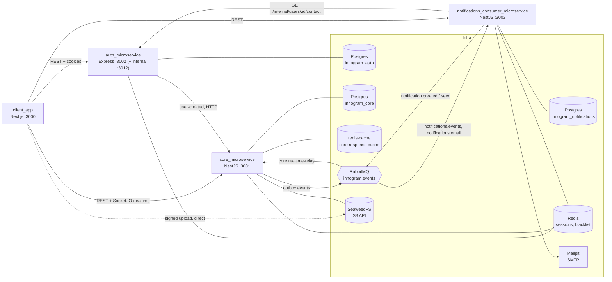

# Innogram

Innogram is a social media application: profiles, posts, comments, likes, follows, real-time chats and notifications. It is a Turborepo + npm-workspaces monorepo (Node 20, TypeScript) made of three backend services and a web client.

## Architecture



- **auth** owns credentials, JWTs, Redis-backed sessions and Google OAuth. Bare Express with manual DI (`createApp()`).
- **core** owns the social graph and content (profiles, posts, comments, chats, follows, assets) and the `/realtime` Socket.IO gateway. NestJS, Hexagonal/DDD.
- **notifications** owns notifications and email preferences, consumes RabbitMQ and sends mail over SMTP.
- **client** is the Next.js App Router web app. It imports `@repo/contracts` only.

Auth tells core about new users over HTTP (fire and forget, internal token); everything between core and notifications goes through RabbitMQ. See [`DDD_ARCHITECTURE_GUIDE.md`](DDD_ARCHITECTURE_GUIDE.md) for the layering.

## Repository layout

```
apps/
  core_microservice/                     NestJS API, DDD
  auth_microservice/                     Express auth service
  notifications_consumer_microservice/   NestJS notifications + RabbitMQ consumers
  client_app/                            Next.js web client
packages/
  contracts/                             @repo/contracts: wire-format types, zero dependencies (client-safe)
  shared/                                @repo/shared: backend-only infra (never import from the client)
docker/                                  Postgres init, SeaweedFS and monitoring configs
docs/                                    Deployment, environment, observability, API docs
```

## Prerequisites

- Node.js 20 and npm
- Docker with Compose v2 (Postgres, Redis, RabbitMQ, SeaweedFS and Mailpit run in containers)

## Quick start (local development)

```bash
cp .env.example .env     # review the required values, see docs/ENVIRONMENT.md
npm ci
npm run docker:up        # Postgres, Redis, redis-cache, RabbitMQ, SeaweedFS, Mailpit
npm run db:migrate       # migrations for auth, core and notifications
npm run db:seed          # optional: dev users and content (auth + core)
npm run dev              # all services and the client in watch mode
```

Open the client at <http://localhost:3000>. Dev seed accounts and their shared password live in [`seed/fixtures.ts`](seed/fixtures.ts). Outgoing email is caught by Mailpit at <http://localhost:8025>.

`@repo/shared` and `@repo/contracts` are consumed through their built `dist/`. `npm run dev` and `npm run build` build them first through Turborepo; to run a single app on its own, run `npm run build -w @repo/contracts -w @repo/shared` first.

## Ports and URLs

| What                   | URL / port                                        | Notes                                                                                               |
| ---------------------- | ------------------------------------------------- | --------------------------------------------------------------------------------------------------- |
| Client                 | <http://localhost:3000>                           | `CLIENT_PORT`                                                                                       |
| Core API               | <http://localhost:3001>                           | `CORE_PORT`; Swagger UI `/api`, JSON `/api-json`                                                    |
| Auth API               | <http://localhost:3002>                           | `AUTH_PORT`; Swagger UI `/api/`, JSON `/api-json`                                                   |
| Notifications API      | <http://localhost:3003>                           | `NOTIFICATIONS_PORT`; Swagger UI `/api`, JSON `/api-json`                                           |
| Auth internal listener | 127.0.0.1:3012                                    | `AUTH_INTERNAL_PORT`; never publish it                                                              |
| Postgres               | localhost:5432                                    | databases `innogram_auth`, `innogram_core`, `innogram_notifications`                                |
| Redis / redis-cache    | localhost:6379 / localhost:6380                   | sessions and blacklists / core response cache                                                       |
| RabbitMQ               | amqp 5672, management UI <http://localhost:15672> | login from `RABBITMQ_DEFAULT_USER` / `RABBITMQ_DEFAULT_PASS`                                        |
| SeaweedFS S3 API       | <http://localhost:9000>                           | `S3_PORT`                                                                                           |
| Mailpit                | SMTP 1025, UI <http://localhost:8025>             |                                                                                                     |
| Grafana                | <http://localhost:3030>                           | monitoring profile only; user `admin`, password `GRAFANA_ADMIN_PASSWORD`; anonymous viewers allowed |
| Prometheus             | no host port                                      | monitoring profile only; see [`docs/OBSERVABILITY.md`](docs/OBSERVABILITY.md)                       |

Swagger UIs are on by default and off when `NODE_ENV=production`, unless `SWAGGER_ENABLED` says otherwise ([`docs/API.md`](docs/API.md)).

Optional monitoring (Prometheus + Grafana, scraping the services running on the host):

```bash
docker compose --profile monitoring up -d   # needs GRAFANA_ADMIN_PASSWORD in .env
```

## Scripts

Run from the repository root. Most delegate to `turbo run`; to target one workspace use `npm run <script> -w <name>`, e.g. `npm run test:cov -w core_microservice`.

| Script                     | What it does                                                                                                     |
| -------------------------- | ---------------------------------------------------------------------------------------------------------------- |
| `npm run dev`              | Start every service and the client in watch mode                                                                 |
| `npm run build`            | Build all packages and apps                                                                                      |
| `npm run test`             | Run the unit tests of every workspace                                                                            |
| `npm run lint`             | ESLint with `--fix`: **rewrites files**. Use it only when you want the fixes applied                             |
| `npm run lint:check`       | ESLint without `--fix`: read-only, this is what CI runs                                                          |
| `npm run type-check`       | `tsc --noEmit` in the four apps, `@repo/shared` and `@repo/contracts`                                            |
| `npm run docker:up`        | Start the infrastructure containers (`docker compose up -d`)                                                     |
| `npm run docker:down`      | Stop and remove the infrastructure containers (volumes are kept)                                                 |
| `npm run docker:apps:up`   | Build and start the full stack in containers with `.env.production` ([`docs/DEPLOYMENT.md`](docs/DEPLOYMENT.md)) |
| `npm run docker:apps:down` | Stop the containerised stack (volumes are kept)                                                                  |
| `npm run db:migrate`       | Run TypeORM migrations in auth, core and notifications                                                           |
| `npm run db:seed`          | Seed dev data into the auth and core databases (`-- --profile perf --reset` for the perf dataset)                |
| `npm run e2e`              | Playwright browser tests in `client_app`; the stack and client must already be running                           |
| `npm run perf`             | k6 gate plus the group fan-out script (needs Docker; core and auth running from `dist`)                          |
| `npm run perf:baseline`    | Measure and write a report to `apps/core_microservice/test/load/reports/`                                        |
| `npm run perf:compare`     | Diff two perf reports                                                                                            |

Coverage (`test:cov`) and API e2e (`test:e2e`) are per-workspace scripts: `npm run test:cov -w <name>`, `npm run test:e2e -w core_microservice` (or `notifications_consumer_microservice`). Browser E2E and perf runs are local only; CI runs lint, build, type-check and unit tests with coverage.

## Documentation

- [`docs/DEPLOYMENT.md`](docs/DEPLOYMENT.md): images, `.env.production`, the container stack, upgrades and rollback
- [`docs/ENVIRONMENT.md`](docs/ENVIRONMENT.md): every environment variable
- [`docs/OBSERVABILITY.md`](docs/OBSERVABILITY.md): health, metrics, logs, alerts, monitoring stack
- [`docs/API.md`](docs/API.md): Swagger URLs, auth flow, API conventions
- [`docs/realtime.md`](docs/realtime.md): the `/realtime` Socket.IO contract
- [`DDD_ARCHITECTURE_GUIDE.md`](DDD_ARCHITECTURE_GUIDE.md): backend layering and conventions
- [`CONTRIBUTING.md`](CONTRIBUTING.md): branches, commits, gates, PR checklist
- Service READMEs: [core](apps/core_microservice/README.md), [auth](apps/auth_microservice/README.md), [notifications](apps/notifications_consumer_microservice/README.md), [client](apps/client_app/README.md), [shared](packages/shared/README.md), [contracts](packages/contracts/README.md)

## License

[MIT](LICENSE)
